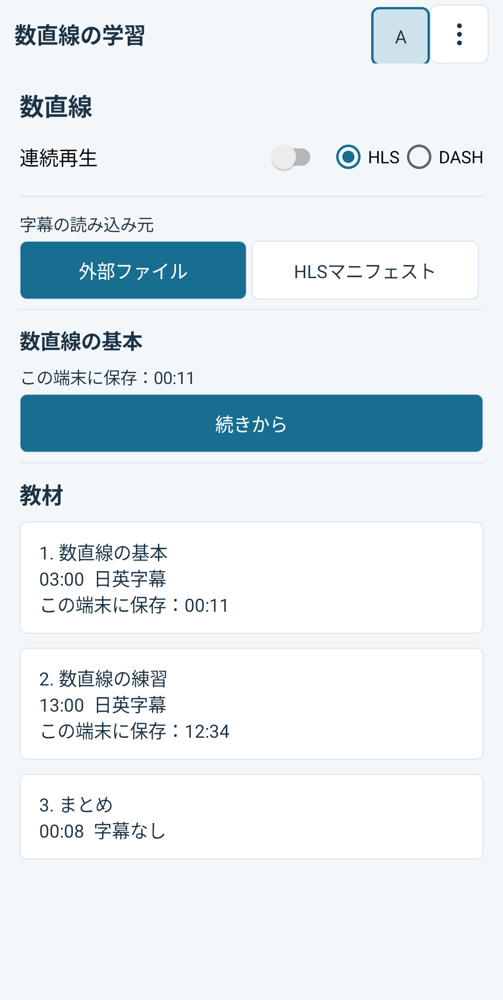
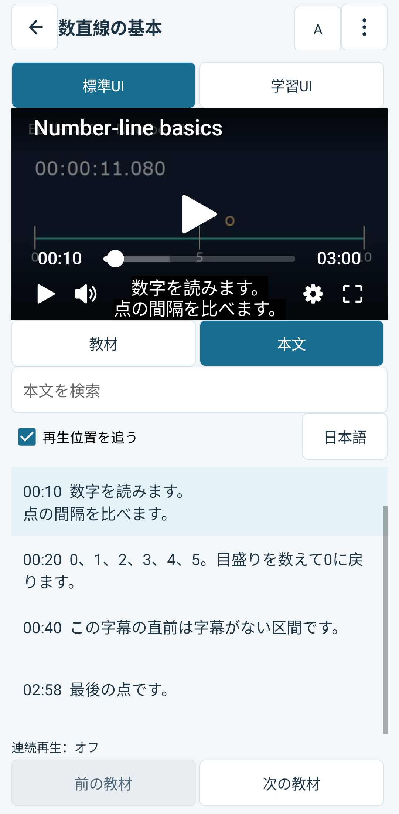
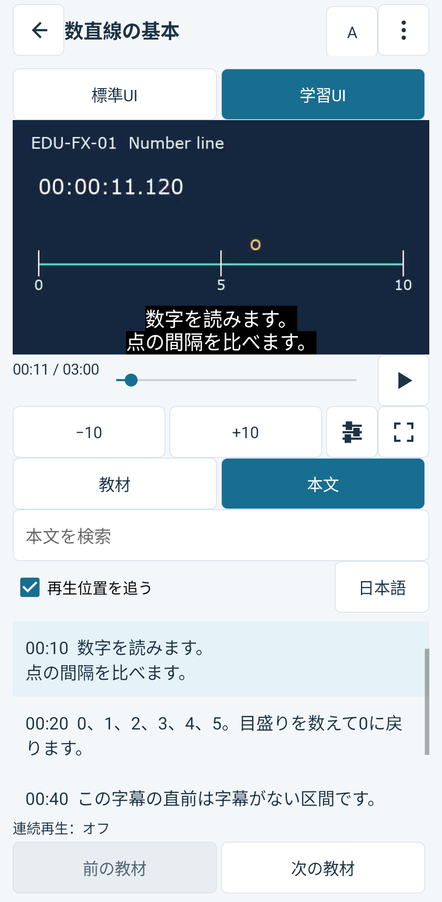

<a id="learning-reference"></a>

# 学習用リファレンス

[English](README.md) · [日本語](README.ja.md) · [実装ガイド](docs/implementation.ja.md) · [再生品質ダッシュボード](analytics-dashboard/README.ja.md)

Bitmovin Playerを使ったコース再生用の独立したAndroidサンプルです。教材の選択、時間付き本文の検索、字幕言語の変更、デモ利用者A・Bごとの途中再開を試せます。再生セッションを保ったまま、SDKの標準Web UIと学習用のネイティブUIを切り替えられます。

アプリ、設定、Gradle wrapper、素材の入力データ、素材サーバー、分析用Webアプリはこのディレクトリ内にあります。ディレクトリをコピーして個別にビルドでき、ほかのPlayer Labアプリのコードやビルド成果物には依存しません。

[再生からAnalyticsでの確認まで](docs/analytics.ja.md)では、教材のデータ収集、Bitmovin Dashboardでの確認、ローカル画面での取得を順に説明しています。

[再生品質ダッシュボード](analytics-dashboard/README.ja.md)も利用できます。キー不要のデモ画面と、Analyticsから実測データを取得する画面があります。

<a id="requirements"></a>

## 必要な環境

- JDK 21、Android SDK platform 37、Android build tools 36.0.0。
- 再生用のAndroid 6.0以降の端末、またはAndroid仮想端末。
- ローカル素材の生成用にPython 3.9以降と、`drawtext`フィルターを含むFFmpeg。
- 任意の分析用ダッシュボードを使う場合はNode.js 24.19.0。

Bitmovin Player Androidは、統合Analytics collectorを含む**3.172.0**に固定しています。`com.playerlab.elearning`を許可したPlayerライセンスが必要です。Analyticsは別のライセンスで、利用は任意です。

<a id="configure-and-run-android"></a>

## Androidの設定と起動

このディレクトリで次のコマンドを実行してください。

```sh
cp android/.env.example android/.env
```

`android/.env`の`BITMOVIN_PLAYER_LICENSE_KEY`にPlayerキーを設定してください。再生データを収集する場合は、`BITMOVIN_ANALYTICS_LICENSE_KEY`も設定します。この設定ファイルは本アプリ専用です。ほかの場所にある環境設定ファイルは自動では読み込みません。

`MEDIA_BASE_URL`は素材サーバーの配信元です。初期値の`http://10.0.2.2:8621/`はAndroid仮想端末からこのコンピューターへ接続するためのアドレスです。実機では同じ素材パスを提供し、その端末から接続できるHTTPSの配信元を指定してください。キーと素材の配信元はビルド時の設定なので、変更後は再ビルドが必要です。

自作の開発用素材を生成し、素材サーバーを起動したままにしてください。

```sh
python3 tools/media/media.py generate
python3 tools/media/media.py serve
```

macOSの標準的なHomebrew版FFmpegには、`drawtext`が含まれない場合があります。システムのFFmpegを変更せず、対応するビルドを指定できます。

```sh
FFMPEG_BIN="$(brew --prefix ffmpeg-full)/bin/ffmpeg" python3 tools/media/media.py generate
```

別のターミナルでビルドし、対象の端末へインストールしてください。

```sh
cd android
./gradlew :app:assembleDebug
adb -s DEVICE_SERIAL install -r app/build/outputs/apk/debug/app-debug.apk
adb -s DEVICE_SERIAL shell am start -n com.playerlab.elearning/.MainActivity
```

PlayerとAnalyticsのライセンスキーはAPK（Androidアプリのインストール用ファイル）に含まれます。対象のアプリIDを許可した専用のデモライセンスを使ってください。アカウントの管理APIキーは分析サーバーの非公開の設定にだけ保存します。

<a id="try-the-learning-flow"></a>

## 画面と操作

コースを開き、次の教材へ自動で進むかを選択します。この設定は教材を開くときに適用されます。教材一覧を見ているだけでは再生を開始しません。



再生中に標準UIと学習UIを切り替えられます。字幕と再生速度の選択は維持され、どちらのUIからもコースと本文を開けます。字幕をオフにしていても本文を検索できます。検索結果を選ぶと、その行の元の開始位置へ移動し、字幕はオフのままです。

| 標準UI | 学習UI |
| --- | --- |
|  |  |

「その他」から「診断ログ」を開くと、再生イベントを確認できます。字幕や映像の読み込みに失敗した場合は、再試行するかコースへ戻れます。取得先のURLは画面やログへ表示しません。

再開位置はデモ利用者と教材の組み合わせごとに保存します。教材を開くときに、続きから再開するか最初から再生するかを選べます。利用者を切り替えると、PlayerとAnalyticsのセッションも切り替わります。端末内の再開情報は受講完了の記録や複数端末で同期する学習記録ではありません。

教材が短いファイルに差し替えられ、保存位置が実際の尺の範囲外になった場合は、最初から再生するかコースへ戻るかを選べます。自動で終端へ移動したり、読み込み中の位置で保存内容を上書きしたりはしません。

同梱するコースは自作の数直線教材です。短い教材、12:34の再開確認位置がある長い練習教材、字幕のないまとめを用意しています。HLSとDASHは同じ教材IDを使います。[素材の説明](docs/fixtures.ja.md)に、尺、字幕の入力データ、検証範囲を記載しています。生成した動画はGit管理対象外です。

<a id="check-the-application"></a>

## アプリの確認

```sh
python3 -B -m unittest discover -s tools/media -p 'test_*.py'
cd android
./gradlew :app:testDebugUnitTest :app:lintDebug :app:assembleDebug :app:assembleDebugAndroidTest
```

ライセンスを設定し、生成した素材へ接続できるテスト端末では、その端末を明示してテスト一式を実行できます。ドライバーはAPKをビルドし、JUnitのテストメソッドが実行可能かを確認してから、両方の配信形式を実行します。プロセス再起動の確認では状態の保存と復元の間に本アプリを強制停止します。全テストでは実際のimpression（Analyticsの再生計測単位）の継続も確認するため、Analyticsライセンスが必要です。アプリ自体はAnalyticsを無効にしても利用できます。

```sh
cd android
python3 scripts/run-device-tests.py --serial DEVICE_SERIAL \
  --media-base-url https://media.example/ --stream-format both
```

`DEVICE_SERIAL`には対象端末の識別子を指定してください。`https://media.example/`は例示用のアドレスなので、実際の素材配信元に置き換えます。私有の端末ログとAPKのハッシュは、Git管理対象外の`android/build/device-tests/`へ保存します。ビルド、ローカル素材サーバー、端末での再生、クラウド配信は、それぞれ別の確認結果です。記録した条件は[検証結果](docs/validation.ja.md)を参照してください。
