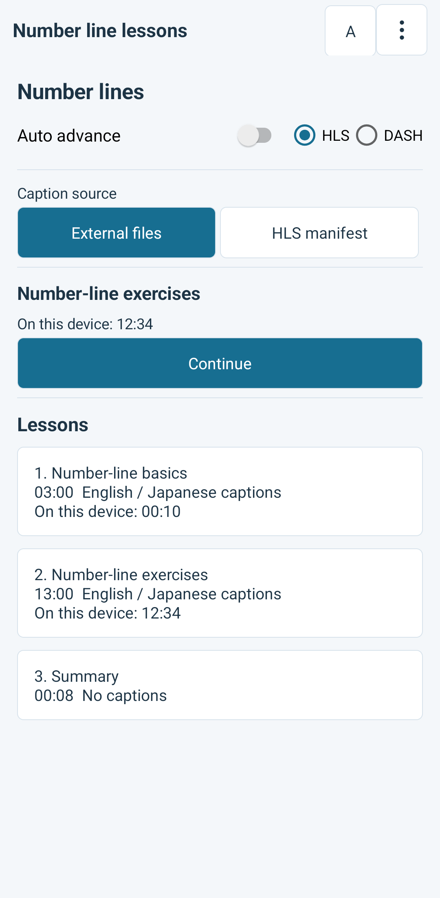
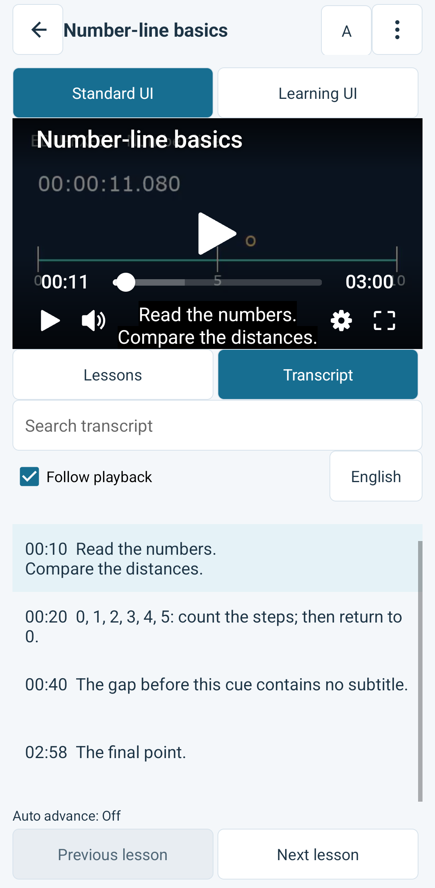
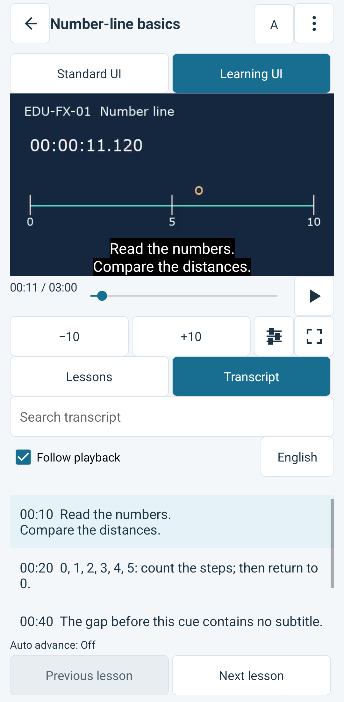

# Learning reference

[日本語](README.ja.md) · [Implementation guide](docs/implementation.md) · [Analytics dashboard](analytics-dashboard/README.md)

An independent Android example for course playback with Bitmovin Player. Select
a lesson, search its timed transcript, change subtitle language, and resume a
lesson for demo learner A or B. Switch between the SDK's standard Web UI and
native learning controls while keeping the current playback session.

This directory contains its own application, configuration, Gradle wrapper,
fixture inputs, media publisher and analytics application. It can be copied and
built independently. It does not use another Player Lab application's code or
build output.

## Requirements

- JDK 21, Android SDK platform 37 and Android build tools 36.0.0.
- Android 6.0 or later for playback. An Android emulator or Android device.
- Python 3.9 or later and FFmpeg with the `drawtext` filter for local fixtures.
- Node.js 24.19.0 for the optional analytics dashboard.

The application pins Bitmovin Player Android **3.172.0**, including the integrated
Analytics collector. A Player license that allows `com.playerlab.elearning` is
required. Analytics uses a separate, optional license.

## Configure and run Android

Run the following from this directory:

```sh
cp android/.env.example android/.env
```

Set `BITMOVIN_PLAYER_LICENSE_KEY` in `android/.env`. To collect playback data,
also set `BITMOVIN_ANALYTICS_LICENSE_KEY`. This file belongs to this application;
no environment file elsewhere is loaded automatically.

`MEDIA_BASE_URL` points to the media publisher. Its default,
`http://10.0.2.2:8621/`, reaches this computer from the Android emulator. For a
physical device, use a reachable HTTPS origin containing the same media paths.
Keys and media origins are build settings, so rebuild after changing them.

Generate the self-authored development media and keep the publisher running:

```sh
python3 tools/media/media.py generate
python3 tools/media/media.py serve
```

On macOS, the standard Homebrew FFmpeg build may omit `drawtext`. A build with
that filter can be selected without changing the system's FFmpeg:

```sh
FFMPEG_BIN="$(brew --prefix ffmpeg-full)/bin/ffmpeg" python3 tools/media/media.py generate
```

In another terminal, build and install on the intended device:

```sh
cd android
./gradlew :app:assembleDebug
adb -s DEVICE_SERIAL install -r app/build/outputs/apk/debug/app-debug.apk
adb -s DEVICE_SERIAL shell am start -n com.playerlab.elearning/.MainActivity
```

The Player and Analytics license keys are packaged in the APK. Use dedicated
demo licenses with the correct application allowlist. Account API keys belong
only in the analytics server's private configuration.

## Try the learning flow

Open the course and choose whether to continue automatically to its next lesson.
This choice applies when opening the course. Browsing the lesson list does not
start playback.



Choose standard or learning UI during playback. Subtitle and speed preferences
remain selected. Both modes keep access to the course and transcript. A
transcript search works even when subtitles are off; selecting a result seeks
to its original cue start without turning subtitles on.

| Standard UI | Learning UI |
| --- | --- |
|  |  |

Open **More → Diagnostics** to inspect structured playback events. Caption or
media failures offer Retry and a return to the course without exposing request
URLs in the screen or log.

Resume positions are saved per demo learner and lesson. When opening a lesson,
choose to resume or start again. Selecting another learner starts a separate
Player and Analytics session. Local resume data is not a learning-completion
record or a service synchronized across devices.

If a lesson was replaced with a shorter file, a saved position outside its
actual duration offers a restart or return to the course. It does not silently
jump to the end or overwrite the saved position while loading.

The supplied course contains self-authored number-line lessons: a short lesson,
a longer exercise with a 12:34 checkpoint, and a subtitle-free summary. HLS and
DASH use the same lesson IDs. The [fixture notes](docs/fixtures.md) explain their
durations, subtitle inputs and validation scope. Generated media stays out of Git.

## Check the application

```sh
python3 -B -m unittest discover -s tools/media -p 'test_*.py'
cd android
./gradlew :app:testDebugUnitTest :app:lintDebug :app:assembleDebug :app:assembleDebugAndroidTest
```

With the generated media reachable from a licensed test device, run the device
suite against that exact device. The driver builds the APKs, checks that the
JUnit methods are executable, and runs both delivery formats. It also force
stops this application between saving and verifying the process-restart state.
The complete suite also requires the Analytics license to check real impression
continuity; the application itself can run with Analytics disabled.

```sh
cd android
python3 scripts/run-device-tests.py --serial DEVICE_SERIAL \
  --media-base-url https://media.example/ --stream-format both
```

`https://media.example/` is a placeholder. Private device logs and APK hashes
are written under the ignored `android/build/device-tests/` directory. Build
checks, local publisher checks, device playback and cloud delivery are distinct results. See
[validation](docs/validation.md) for the recorded conditions.
