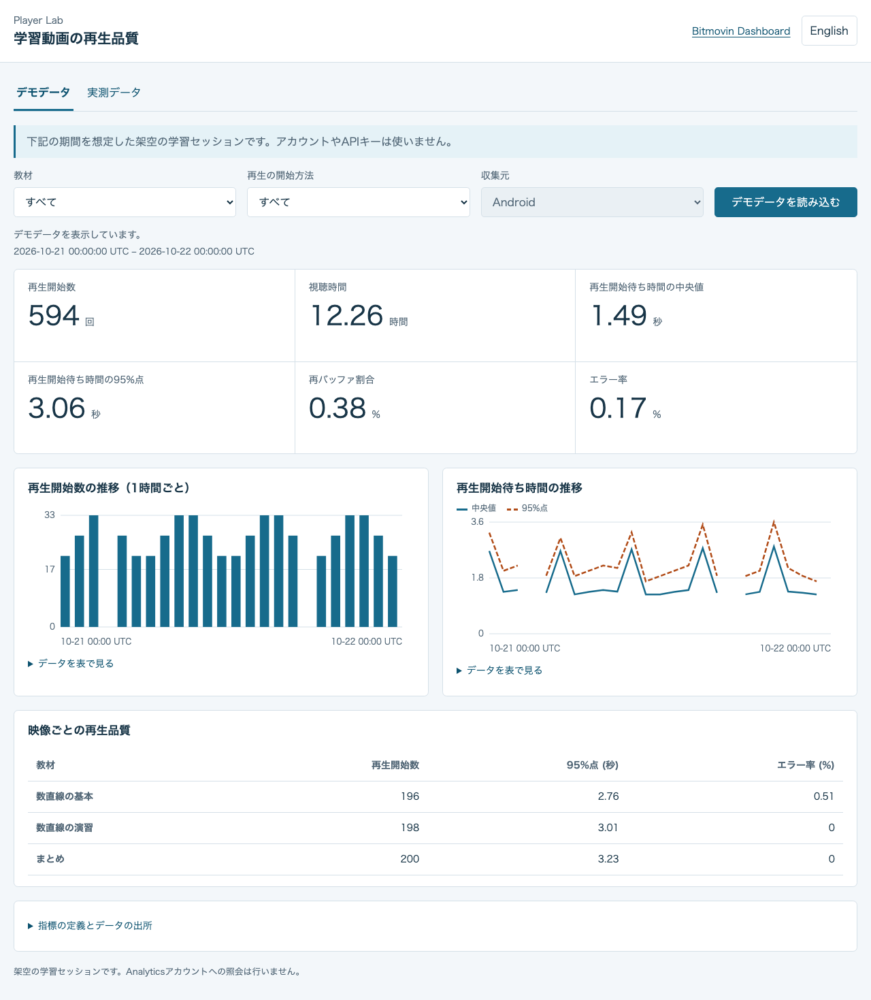
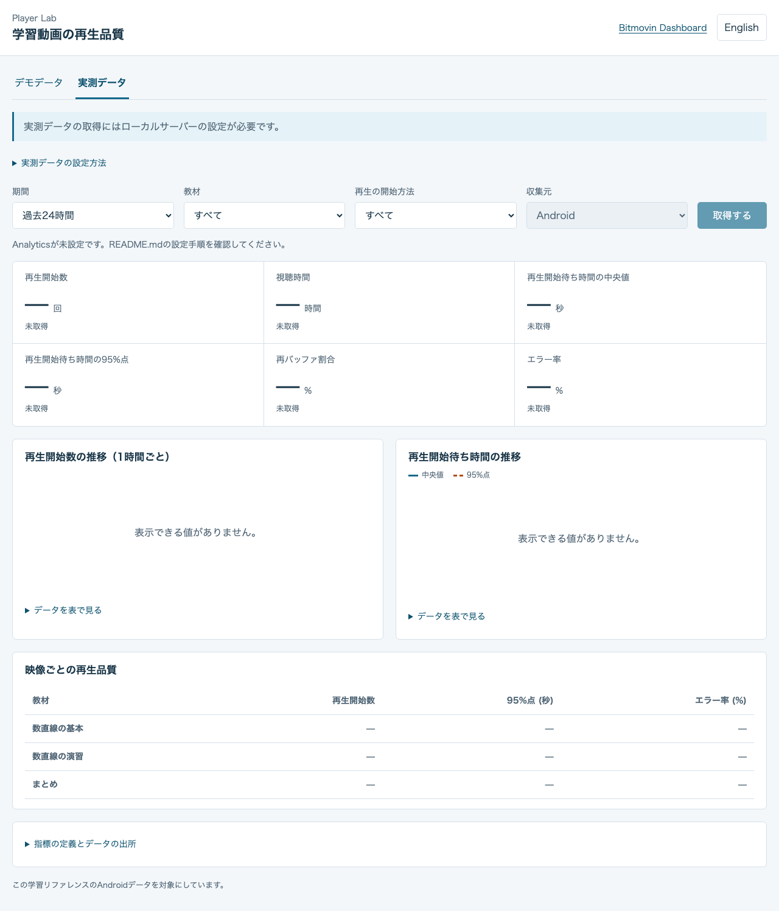

<a id="learning-playback-quality-dashboard"></a>

# 学習用アプリの再生品質ダッシュボード

[English](README.md) · [日本語](README.ja.md)

架空のデモデータで再生品質の見方を確認し、このリファレンスアプリの実測データもAnalyticsから取得できるWebアプリです。画面は英語と日本語に対応しています。ダッシュボードとそのサーバーはAndroidのビルドとは独立して起動できます。

Androidでの再生から収集結果を確認するまでの流れは、[再生からAnalyticsでの確認まで](../docs/analytics.ja.md)を参照してください。

<a id="setup"></a>

## 設定と起動

Node.js 24系の24.13以降を使用してください。

```sh
cd analytics-dashboard
npm ci
npm start
```

`http://127.0.0.1:9051`を開くと「デモデータ」を表示します。`.env`やAPIの認証情報は不要です。

<a id="demo-data"></a>

## デモデータ

デモは画面に表示した日付を想定した架空の学習セッションです。教材と再生開始方法の絞り込みはローカルで行い、「デモデータを読み込む」を押すと同じサンプルを再表示します。カード、時間別グラフ、教材ごとの比較は、この架空の観測値を使います。画面には対象期間とデータの出所を表示し、実測の再生結果と区別しています。



<a id="measured-data"></a>

## 実測データ

サーバーを停止し、このディレクトリに非公開の設定ファイルを作成してください。

```sh
cp .env.example .env
```

`.env`を編集してください。

| 変数 | 設定する値 |
| --- | --- |
| `BITMOVIN_API_KEY` | Analyticsの読み取り照会に必要な権限を持つ、BitmovinアカウントのAPIキー。Playerライセンスキーとは異なります。 |
| `BITMOVIN_ANALYTICS_LICENSE_KEY` | このリファレンスアプリが使用するAnalyticsライセンス。 |
| `PORT` | 任意のローカルポート。初期値は`9051`です。 |

サーバーが読み込む`.env`は、このダッシュボードのディレクトリにあるものだけです。Androidの設定ファイルや親ディレクトリの`.env`は読み込みません。このファイルは非公開で管理してください。どちらのキーもブラウザーへ返しません。

```sh
npm start
```

`http://127.0.0.1:9051/#measured`を開き、期間と教材を選んで「取得する」を押してください。絞り込み条件を変えるだけではAnalyticsへ照会しません。「取得する」を押すたびにAPIへ照会します。収集直後のイベントはまだ含まれていない場合があります。画面には応答の取得時刻を表示し、設定がない状態、データがない状態、値がゼロの状態、照会に失敗した状態を区別します。照会に失敗してもデモデータに置き換えません。



再生データの収集と、この読み取り専用の照会サーバーは別の処理です。ダッシュボードを起動しても再生セッションは作成されません。

<a id="available-data"></a>

## 取得できるデータ

照会するのは、Androidの`EDU-FX-01`、`EDU-FX-02`、`EDU-FX-03`のデータだけです。再生開始経路の絞り込みにはアプリの`customData1`を使います。教材の選択・途中再開は`catalog`、教材間の遷移は`playlist`です。初版のダッシュボードには、ブックマーク操作の収集と分析は含まれません。

| 指標 | 照会方法 | 表示方法 |
| --- | --- | --- |
| 再生開始数 | `VIDEO_STARTUPTIME > 0`の`IMPRESSION_ID`を数える | 件数 |
| 視聴時間 | `PLAYED > 0`の`PLAYED`を合計する | ミリ秒を3,600,000で割り、時間に換算する |
| 再生開始までの時間の中央値 | 正の`VIDEO_STARTUPTIME`の中央値 | ミリ秒を1,000で割り、秒に換算する |
| 再生開始までの時間の95パーセンタイル | 同じ正の値の95パーセンタイル | ミリ秒を1,000で割り、秒に換算する |
| 再バッファ割合 | `REBUFFER_PERCENTAGE`の平均 | 標準APIと同じパーセント単位を使う |
| エラー率 | `ERROR_PERCENTAGE`の平均 | 標準APIと同じパーセント単位を使う |

照会では任意のコンテキスト列を明示的に無効にしています。ダッシュボードはドキュメントで定義された指標結果の形式だけを処理します。カードは選択した期間全体を照会し、時間別グラフと映像別の比較には別の照会を使います。時間別のパーセンタイルを平均して、期間全体の値にすることはありません。データのない時間をゼロで埋めず、折れ線も欠けた時間をまたいでつなぎません。各グラフにはデータ表もあります。

表示する取得時刻は、サーバーがAPI応答を受信した時刻です。これらの集計照会から、最新の生データが到着した時刻は分かりません。Bitmovin Dashboardでは、同じ期間と映像IDで比較してください。[公式の指標照会例](https://developer.bitmovin.com/playback/docs/how-to-recreate-dashboard-queries-via-the-api-1)と[Percentile APIリファレンス](https://developer.bitmovin.com/playback/reference/postanalyticsqueriespercentile)も参照できます。

<a id="local-server-limits"></a>

## ローカルサーバーの制限

サーバーは`127.0.0.1`で待ち受け、localhostのHostとOriginだけを受け付けます。配信するのは、固定の静的ファイルと`GET /api/config`、`GET /api/qoe`です。任意のAPIへ転送するプロキシではありません。クライアントのパラメーターから、上流URL、アカウントキー、Analyticsライセンス、集計軸、プラットフォームは変更できません。

照会期間は最長7日で、グラフは時間単位です。上流への同時リクエストは最大3件、1回の取得に含まれる照会全体の制限時間は10秒です。取得済みの応答はキャッシュせず、次の取得操作でもAPIへ照会します。同じ条件のリクエストがすでに進行中の場合は処理を共有します。照会の一括処理は同時に最大2件です。上流の各ページは200行までとし、`offset`で続きのページを取得します。ページ取得が途中で終わった場合はエラーとして報告します。応答サイズにも上限があります。リクエスト数の制限には`Retry-After`に従い、制限時間内で短い再試行を最大1回だけ行います。指標の照会に失敗しても、値をゼロやデモデータに置き換えません。同じ選択条件の取得に失敗した場合は、以前に取得できた結果であることを表示します。

ブラウザーから受信機のデータは選択できません。Android送信側のデータだけでは、受信機の再生品質は確認できません。このローカル開発サーバーには認証機能がないため、公開インターフェースで待ち受けさせないでください。

<a id="checks"></a>

## 確認コマンド

```sh
npm test
npm run build
```

テストでは架空データと絞り込み、照会の入出力仕様、ページ取得、同時実行、繰り返しの再照会、リクエスト数の制限、制限時間、応答の上限、Originの検査、秘密情報を含まないエラー、ブラウザーに遅れて届く古い応答、グラフの欠損値を確認します。`build`はJavaScriptモジュールと静的ファイルを検査します。生成されるバンドルや実行時の依存パッケージはありません。
