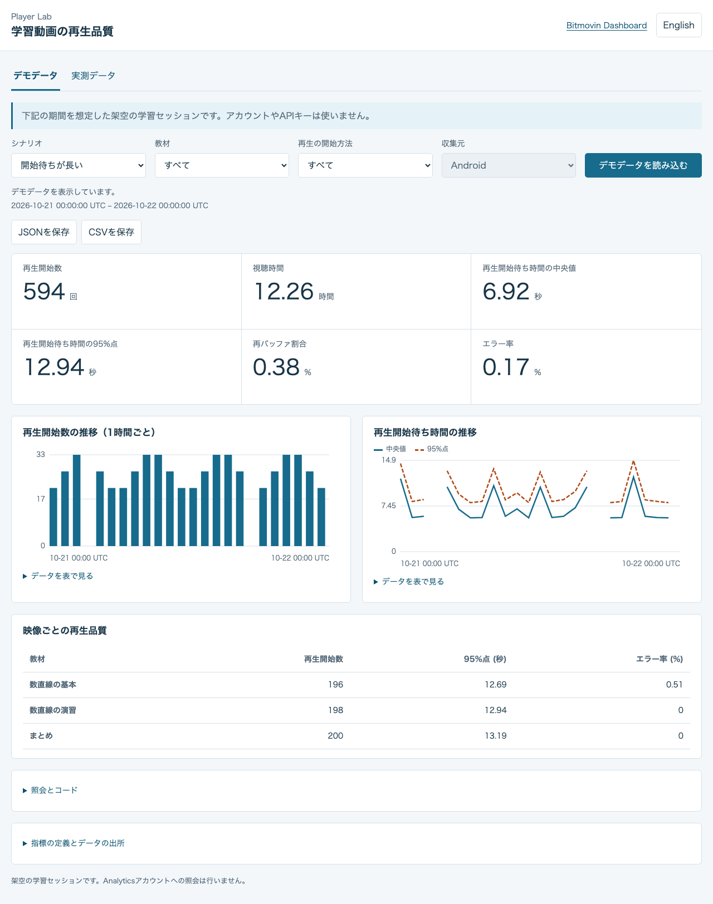
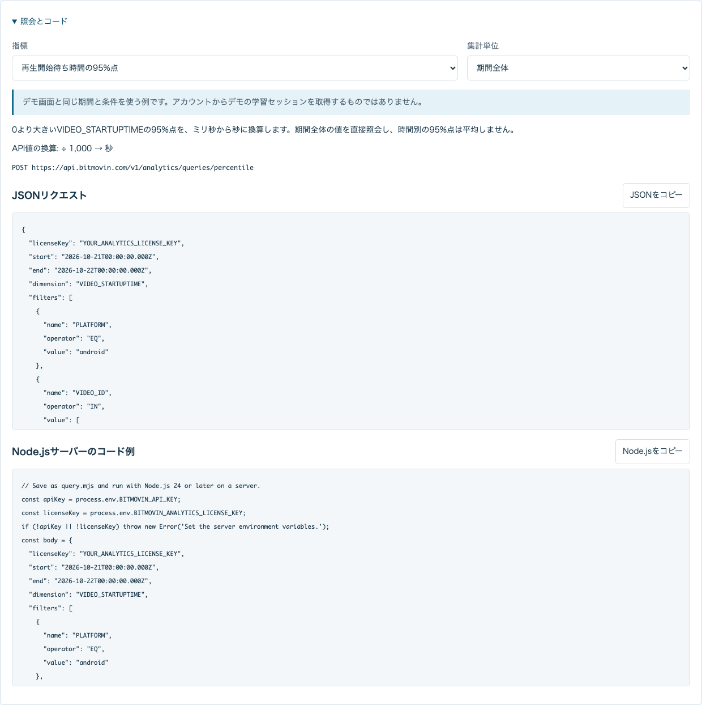

# 照会例と結果の分析

[English](query-and-analysis.md) · [日本語](query-and-analysis.ja.md)

[ローカルダッシュボード](../README.ja.md#setup)を起動し、「デモデータ」を開いてください。APIキーは不要です。教材、再生の開始方法、シナリオを選ぶと、架空の学習セッションを比較できます。「通常」「開始待ちが長い」「再バッファが多い」は、それぞれのセッションの入力値を変えています。同じ教材と開始方法では、再生開始数と視聴時間は変わりません。開始待ち時間の中央値と95%点は元のセッションから求めており、時間別の値を平均したものではありません。

## 照会を確認する

「照会とコード」を開き、指標と集計単位を選んでください。選べるのは、ダッシュボードが実際に使う集計です。カードは期間全体、グラフは1時間ごと、比較表は映像ごとに照会します。期間全体の照会だけを使う指標もあります。

この欄には指標の定義、表示単位、APIの送信先、JSONリクエスト、Node.jsサーバーのコード例があります。画面と実際のサーバーは[同じリクエスト生成処理](../public/query-recipes.mjs)を使います。JSONのAnalyticsライセンスは差し替え用の値です。コードはサーバーの環境変数`BITMOVIN_API_KEY`と`BITMOVIN_ANALYTICS_LICENSE_KEY`を読み込みます。実際の値はブラウザーへ送りません。コピーしたコードを`query.mjs`に保存し、これらの変数を設定したサーバーで`node query.mjs`を実行してください。

欄を開いたりコードをコピーしたりするだけでは、アカウントへ照会しません。コピーしたコードを実行するとAnalyticsへ照会します。コード例は最大800行までのページ取得に対応し、途中で終わった場合はエラーにします。欠損値をnullのまま残し、単位を換算します。ダッシュボードのサーバーにある同時実行の調整、応答サイズの上限、照会回数の制限に対する再試行は含みません。サーバー全体の動作は[ローカルサーバーの制限](../README.ja.md#local-server-limits)を参照してください。

結果を表示している場合、コード例はその結果の期間と条件を使います。前回の結果を残している場合も、その元の条件を保ちます。結果がない場合は、現在選んでいる有効な条件を使います。デモでは画面に表示した架空の日付と条件を使います。その学習セッションがAnalyticsアカウントに存在するわけではありません。「実測データ」はAndroidと本サンプルの教材IDを対象とし、再生の開始方法は`CUSTOM_DATA_1`で指定します。

## 表示中の結果を保存する

「JSONを保存」または「CSVを保存」を押してください。期間全体の指標、時間別の推移、教材ごとの比較を、表示中の結果として保存します。新たにデータを取得したり、分析サービスへ送信したりはしません。結果を表示する前と、取得中は保存できません。条件を変更すると、それまでの結果は消え、次の結果を読み込むまで保存できなくなります。

| 項目 | 内容 |
| --- | --- |
| `schemaVersion` | 保存形式のバージョン。 |
| `dataSource`、`scenario` | `demo`または`measured`。架空のシナリオはデモだけに記録します。 |
| `period`、`filters` | 結果の実際のUTC期間、教材、再生の開始方法、Androidの指定。 |
| `requestedAt`、`fetchedAt`、`exportedAt` | 照会開始、API応答の受信、保存の時刻。デモでは最初の2つはnullです。 |
| `latestSampleAt` | この集計では最新の収集イベントの時刻が分からないため、nullです。 |
| `dataStatus`、`viewStatus` | 結果自体の状態と、直近の取得結果。前回の成功結果を残す場合は、`dataStatus: "ok"`と`viewStatus: "error"`になることがあります。 |
| `isPartial`、`isEarlier` | 一部の照会だけが成功した結果か、前回の結果を表示しているか。 |
| `unit`、`status`、`code`、`value` | 各指標の単位、取得状態、決められたエラーコード、数値またはnull。推移と比較には行データも含みます。 |

ゼロは数値のゼロとして残し、取得できない値や照会に失敗した値はnullにします。推移にデータがない場合、架空の行で補いません。CSVは結果を1行ずつ並べる形式で、各行に期間などの情報を付けます。空欄の値はnullです。コンマ、引用符、改行は引用符で囲んで保持します。表計算ソフトが数式として解釈する可能性のある文字列には、先頭にアポストロフィを付けます。

保存するのは既知の集計項目と教材IDだけです。応答に任意で追加された項目、キー、セッション識別子は含めません。ただし、集計済みの実測データにも非公開の情報が含まれる場合があります。共有する前に内容を確認してください。

## LLMで分析する

[架空の出力例](../examples/fictional-learning-quality.json)はシナリオ「開始待ちが長い」、教材`EDU-FX-01`、再生の開始方法「すべて」のデモから作っています。アカウントのデータは含みません。実測データの利用を検討する前に、このファイルで分析の指示を試せます。ダッシュボードに大規模言語モデル（LLM）への自動送信機能はありません。ファイルを渡すか、どのサービスへ渡すかは利用者が決めます。設定ファイルや認証情報は渡さないでください。

指示の例です。

> この再生品質の出力を分析してください。最初にdataSource、scenario、
> UTCの期間、条件、単位、dataStatus、viewStatus、isPartial、isEarlierを確認してください。
> デモは架空のデータとして扱い、数値のゼロ、null、データのない時間、照会失敗を区別してください。
> 教材を比べるときは期間と条件を合わせてください。期間全体の95%点を使い、
> 時間別の95%点を平均しないでください。
> 観測した差と、判断に足りない情報を分けて述べてください。
> 集計データだけで原因や個々の利用者の状態を断定しないでください。
> 仮説ごとに、追加の照会または再生確認と、それによって何を確かめられるかを示してください。

モデルの計算が保存した数値と合っているか確認してください。開始待ち時間や再バッファの値から症状を見つけても、集計の相関だけでは原因を確定できません。実際のデータ収集とDashboardとの比較は、[教材の再生データをAnalyticsで確認する](../../docs/analytics.ja.md)を参照してください。
