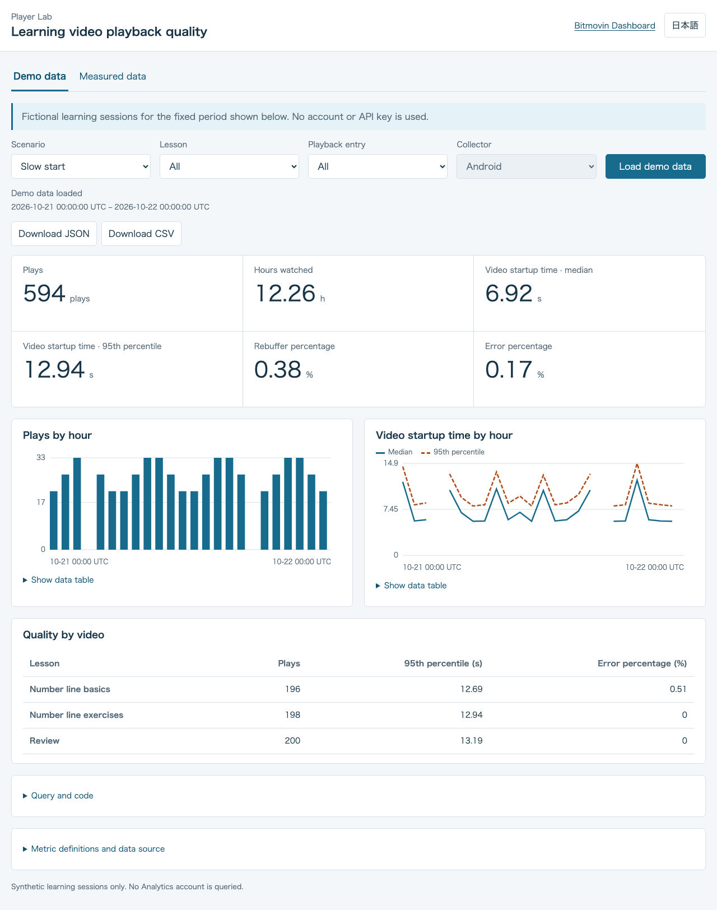
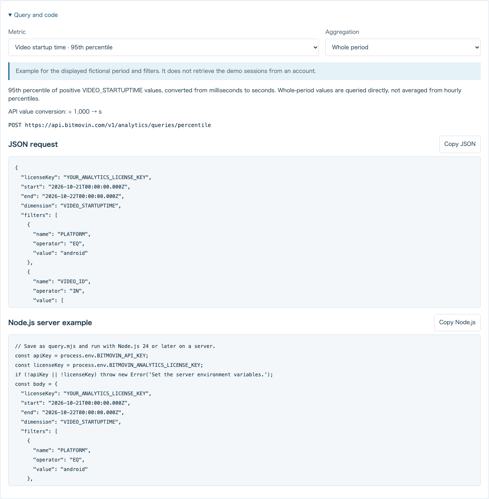

# Query examples and result analysis

[English](query-and-analysis.md) · [日本語](query-and-analysis.ja.md)

Start the [local dashboard](../README.md#setup) and open **Demo data**. No API key is needed. Choose a lesson, playback entry and scenario to compare fictional sessions. **Normal**, **Slow start** and **High rebuffering** change individual session inputs. They keep the same session counts and viewing time for the same lesson and entry. Startup medians and 95th percentiles are calculated from those sessions; they are not averages of the hourly percentiles.

## Inspect a query

Open **Query and code**, choose a metric and select its aggregation. The available aggregations are the ones the dashboard actually uses: whole-period cards, hourly charts and per-video comparisons. Some metrics have only a whole-period query.

The panel shows the metric definition, output unit, API endpoint, JSON request and Node.js server code. Both the panel and the real server use [the same request generator](../public/query-recipes.mjs). The JSON contains an Analytics license placeholder. The code reads `BITMOVIN_API_KEY` and `BITMOVIN_ANALYTICS_LICENSE_KEY` from its server environment; neither actual value is sent to the browser. Save the copied Node.js code as `query.mjs` and run `node query.mjs` on a server with those variables configured.

Opening the panel or copying code makes no account request. Running the copied code does query Analytics. The example handles pagination up to 800 rows, reports incomplete results, preserves null and converts units. Unlike the dashboard service, it does not coordinate simultaneous queries, limit response-body size or retry rate limits. For the full server behavior, see [Local server limits](../README.md#local-server-limits).

If results are displayed, the example uses their actual period and filters. An earlier result keeps its original selection. Without results, the panel uses the current valid selection. The demo example uses its fixed fictional date and filters; those sessions do not exist in your Analytics account. **Measured data** uses Android and this sample's known lesson IDs, with playback entry stored in `CUSTOM_DATA_1`.

## Download the displayed result

Choose **Download JSON** or **Download CSV**. Downloads contain the currently displayed snapshot, including total metrics, hourly series and per-lesson comparisons. They do not fetch new data or send anything to an analysis service. Downloads are unavailable before a result is displayed and while a fetch is pending. A filter change clears the prior result until another result is loaded.

| Field | Meaning |
| --- | --- |
| `schemaVersion` | Export format version. |
| `dataSource`, `scenario` | `demo` or `measured`; the fictional scenario is present only for demo data. |
| `period`, `filters` | The actual result's UTC period, lesson, playback entry and Android platform. |
| `requestedAt`, `fetchedAt`, `exportedAt` | Query start, API response receipt and export times. The first two are null for demo data. |
| `latestSampleAt` | Null because these aggregates do not establish the latest collected event time. |
| `dataStatus`, `viewStatus` | The result's status and the latest fetch outcome. A retained successful result can have `dataStatus: "ok"` and `viewStatus: "error"`. |
| `isPartial`, `isEarlier` | Whether only some queries succeeded and whether the screen is retaining an earlier result. |
| `unit`, `status`, `code`, `value` | Each metric's unit, availability, bounded error code and numeric or null value. Series and comparisons also include their rows. |

Zero remains a numeric zero; unavailable or failed values remain null. Empty series have no invented rows. CSV uses a long table with metadata repeated on each result row; a blank value represents null. Quoting preserves commas, quotes and newlines. A leading apostrophe protects strings that a spreadsheet might interpret as formulas.

The exporter includes only known aggregate fields and known lesson IDs. It omits arbitrary response properties, keys and session identifiers. Aggregated measured data can still be sensitive: review its contents before sharing it.

## Analyze an export with an LLM

The [fictional example export](../examples/fictional-learning-quality.json) is generated from **Slow start**, lesson `EDU-FX-01` and all playback entries. It contains no account data. Use it to try an analysis prompt before considering a measured export. The dashboard has no automatic large language model (LLM) integration; you decide whether and where to upload a file. Never include configuration files or credentials.

Example prompt:

> Analyze this playback-quality export. First identify dataSource, scenario,
> UTC period, filters, units, dataStatus, viewStatus, isPartial and isEarlier.
> Treat demo data as fictional. Distinguish numeric zero, null, missing hours
> and query failures. Compare lessons only within matching periods and filters.
> Use whole-period percentiles directly; never average hourly percentiles.
> Describe observed differences and missing evidence separately. Do not infer
> a cause or a user-level result from aggregate data alone. Suggest a follow-up
> query or playback check for each hypothesis, and state what it would confirm.

Review the model's calculations against the exported numbers. Startup time and rebuffering can reveal a symptom, but aggregate correlations alone do not establish its cause. For real collection and Dashboard comparison, follow [From lesson playback to Analytics](../../docs/analytics.md).
