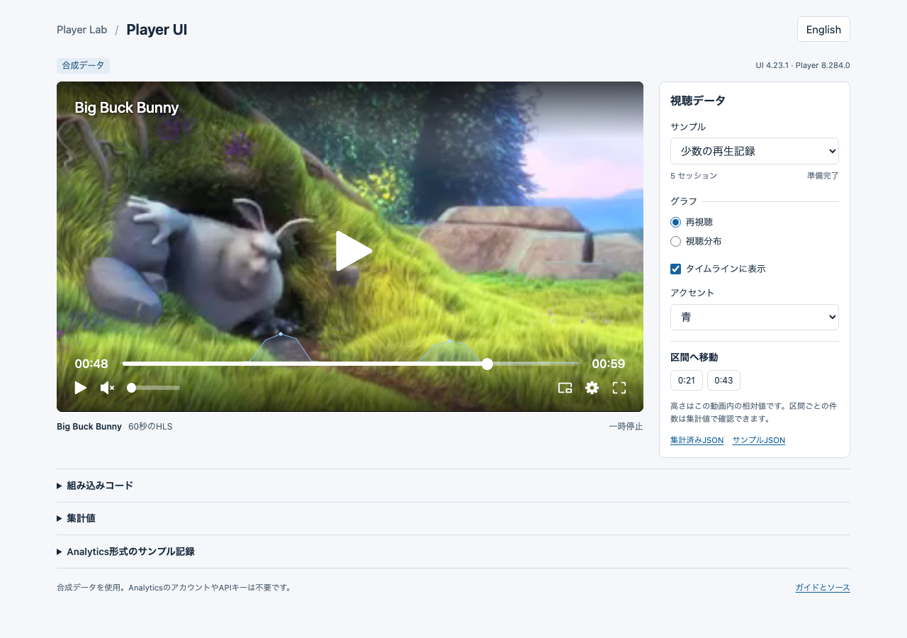

# Player UIリファレンス

[English](README.md) · [日本語](README.ja.md)

公式のBitmovin Player UI v4に視聴傾向グラフを追加する、独立したWebサンプルです。
短いBig Buck Bunnyの映像を再生し、合成した視聴データを切り替えて、
タイムラインに使う集計値を確認できます。

Player **8.284.0**とUI **4.23.1**を使用しています。再生操作には変更を加えていない
公式UIパッケージの部品を使います。グラフはPlayer Labの追加コンポーネントです。
データやグラフの表示を切り替えても、ソースを読み込み直す必要はありません。

UI 4.23.1には日本語の翻訳が含まれていません。Player Labが用意した
[日本語の辞書](src/ui-ja.ts)を、公式UIの公開された
[言語設定API](src/create-player-ui.ts)で読み込んでいます。



## ローカルで起動する

Node.js **24.19.0**を使用します。このディレクトリで次のコマンドを実行してください。

```sh
npm ci
npm run dev
```

`http://localhost:5199/`を開いてください。標準のデモには`.env`ファイル、
Analyticsライセンス、アカウントAPIキーは不要です。Bitmovin Playerはlocalhostでは
Playerキーなしで動作します。公開メディアの再生にはインターネット接続が必要です。

別のドメインで再生する場合は、Playerライセンスでそのドメインを許可し、
開発サーバーの起動時やビルド時にキーを指定してください。

```sh
VITE_PUBLIC_PLAYER_LICENSE_KEY='<public-player-license-key>' npm run build
```

この値はブラウザーへ配信するコードに含まれます。ブラウザーでの公開用に用意した
Playerキーを使ってください。この変数にAnalyticsライセンスやアカウントAPIキーを
設定してはいけません。[Playerの設定](src/playback.ts)も参照してください。

このディレクトリには独自のパッケージとロックファイルがあります。
他のPlayer Labアプリのソースやビルド結果を使わず、コピーして個別にビルドできます。

## グラフを試す

データを選び、公式のシークバーで再生位置を変更してください。
標準の設定メニューには、読み込んだソースで利用できる項目が表示されます。
シークバーのマウス・タッチ・キーボード操作はそのまま使えます。

| データ | 確認する内容 |
| --- | --- |
| `sparse` | 少数の再生セッションでの再視聴 |
| `single` | 一件の再生セッションに基づく表示 |
| `broader` | セッション数を増やした場合の同じ指標 |
| `watched` | 再視聴がない場合の視聴範囲 |
| `empty` | 視聴記録がない場合の表示 |

同梱の記録はすべて合成データです。アカウントからのExportや実際の視聴履歴は
含んでいません。このデモは再生データをAnalyticsへ送信しません。
データの切り替えは準備済みの履歴を切り替える操作であり、現在の視聴を記録するものではありません。

繰り返し再生された範囲があれば再視聴のグラフを表示します。
視聴記録はあっても再視聴がない場合は、視聴分布と明示して表示します。
観測されていない範囲は空白のままです。読み込みエラーを空のデータとして扱うこともありません。

高さは選択した動画内の相対値です。場面の盛り上がりを確率で表したものでも、
多くの視聴者に支持されている確かさを示すものでもありません。
山を比較するときは、その区間の対象セッション数も確認してください。
曲線をなだらかにしても、集計元の件数は増えません。

## 値の計算方法

合成サンプルには公開されている
[Analyticsのサンプルデータ仕様](https://bitmovin.github.io/bitmovin-api-sdk-php/classes/BitmovinApiSdk_Models_AnalyticsImpressionSample.html)にある
`impressionId`、`sequenceNumber`、`videotimeStart`、`videotimeEnd`、`played`、
`state`、`ad`などのフィールドを使っています。動画内の位置と長さはミリ秒単位です。
`DemoExport`という外側の構造はPlayer Labのテストデータ形式であり、
Analytics Export APIの応答や、本番用のExport取り込み処理ではありません。

同じコンテンツのサンプルを順番に並べ、連続した再生範囲を復元します。
同じ連続再生内の画質変更や重複した記録をまとめます。広告、停止中・シーク中のサンプル、
シークで飛ばした範囲は視聴範囲に加えません。以前の位置へ戻った後に再生した場合は、
同じ範囲を再び通った記録として扱います。

区間ごとの再視聴スコアは次の計算です。

```text
各セッションで「二回以上再生した部分」の長さの合計
÷（区間の長さ × 有効な再生セッションの総数）
```

同じセッションで何度見直しても、寄与する長さはその区間の長さまでです。
動画内の長さを使うため、低速で再生しただけでも値は増えません。
区間の一部を見直した場合は、重なった長さだけを加えます。
すべての区間で同じセッション全体を分母にするので、特定の区間に到達した
セッションだけを分母にする計算とは異なります。

視聴分布では一回以上再生した範囲の長さを使います。
`support`は、その区間の再生が記録されたセッション数です。異なる人の数ではありません。
観測のない区間の値は`null`のまま保持し、ゼロを作って埋めません。

## 再生前にデータを準備する

```sh
npm run prepare:data
npm run check:data
```

最初のコマンドは合成サンプルからセッション識別子を含まない集計結果を作ります。
次のコマンドは、コミットされている集計結果と入力データが一致するかを確認します。
ブラウザーが読み込むのは小さな集計結果です。元のサンプルを見る操作は別に用意しています。

CMSへ組み込む場合は、サーバーやバッチ処理で次の処理を実行します。

```text
サンプル単位のExport → 検証・集計 → CMSへの保存 → Player UIで表示
```

コンテンツID、コンテンツのバージョン、集計期間、指標のバージョンを合わせて管理してください。
動画を編集して差し替えた場合は、変更前の位置情報を引き継がないようにします。
期間が重なるExportや、同じファイルの再取り込みによる二重計上も防ぐ必要があります。
完全な結果を確認してから、CMSの最後に使えた集計結果を置き換えてください。
アカウントAPIキーや個別のセッション記録は、ブラウザーへ渡すデータに含めません。

## 別のアプリケーションへ組み込む

[集計データの型](src/types.ts)、[データの検証](src/snapshot.ts)、
[タイムラインコンポーネント](src/EngagementTimeline.ts)、
[集計処理](src/engagement.ts)を参照してください。
再生するコンテンツと一致する`EngagementSnapshot`を検証して渡し、
指標に`replay`または`reach`を選びます。
[公式UIへの組み込み例](src/create-player-ui.ts)では公式のコンテナーにグラフを追加し、
再生位置の操作は公式のシークバーに任せています。

集計データにはコンテンツの識別子と長さ、集計期間、生成時刻、セッション数、
区間幅、区間ごとの再視聴・視聴分布・対象件数が入ります。
コンポーネントへ視聴者の識別子を渡す必要はありません。

標準の操作は[公式UI v4ガイド](https://developer.bitmovin.com/playback/docs/whats-new-in-ui-v4)、
コンテナーのAPIは[公式のコンポーネント構成](https://github.com/bitmovin/bitmovin-player-ui/blob/v4.23.1/src/ts/components/Container.ts)を参照してください。

## 確認とビルド

```sh
npm test
npm run build
npx playwright install chromium
npm run test:browser
```

`build`はデータとTypeScriptを確認してから`dist/`を生成します。
ブラウザーテストはChromiumを使います。ネイティブアプリと他のPlayer Labアプリの
確認は、それぞれ別の手順です。

## ライセンス

Player Labのコードは[MITライセンス](LICENSE)です。Player SDK、公式UI、依存パッケージ、
外部配信の映像は、それぞれのライセンスに従います。[第三者のライセンス](THIRD_PARTY_NOTICES.ja.md)を参照してください。
