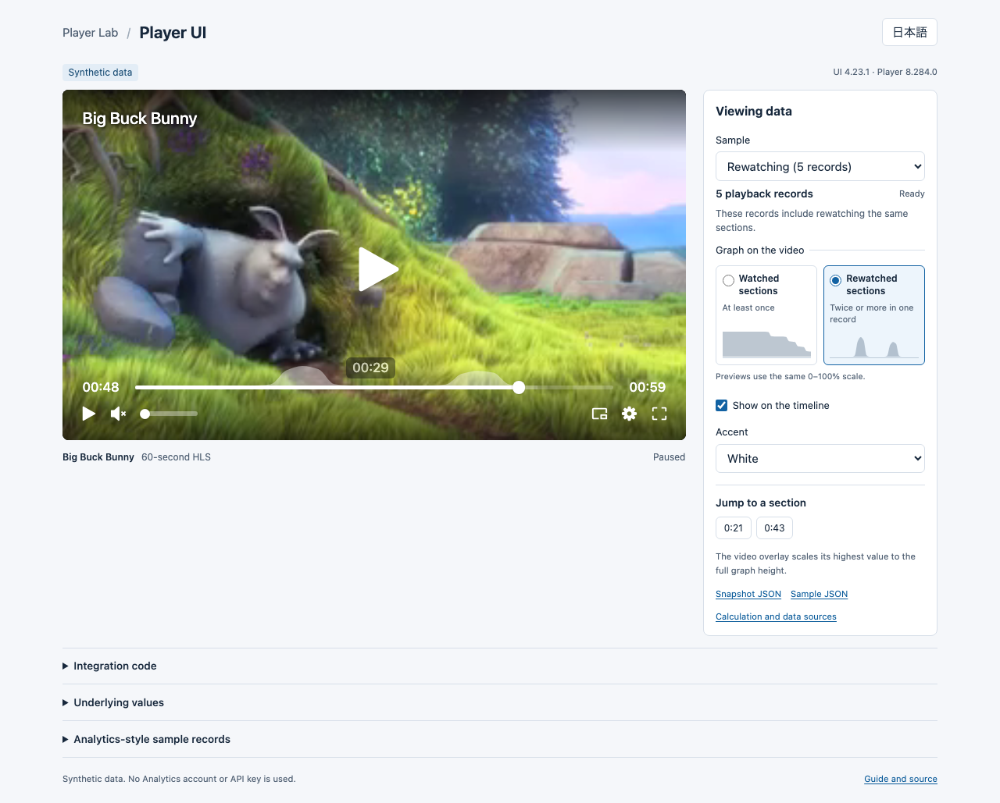

# Player UI reference

[English](README.md) · [日本語](README.ja.md)

An independent Web example that adds a viewing-pattern graph to the official
Bitmovin Player UI v4. The default demo plays a short Big Buck Bunny source with
synthetic viewing data. Change the dataset and inspect the timeline's precomputed
values, or load an optional Observability-derived demo pack.

The example uses Player **8.284.0** and UI **4.23.1**. Standard playback controls
come from the unmodified official UI package. The graph is a separate Player Lab
component; changing its dataset or visibility does not require another source
load.

UI 4.23.1 does not include Japanese translations. Player Lab supplies
[its own Japanese dictionary](src/ui-ja.ts) through the official UI's public
[localization API](src/create-player-ui.ts).



## Run locally

Use Node.js **24.19.0**. Run these commands from this directory:

```sh
npm ci
npm run dev
```

Open `http://localhost:5199/`. The default demo needs no `.env` file, Analytics
license or account API key. Bitmovin Player can run on localhost without a Player
key. The public media source requires Internet access.

For playback on another domain, allow that domain in your Player license and
provide its key when starting the development server or building the app:

```sh
VITE_PUBLIC_PLAYER_LICENSE_KEY='<public-player-license-key>' npm run build
```

This value is included in the browser code. Use a Player key intended for public
browser delivery. Never put an Analytics license or an account API key in this
variable. See [the Player configuration](src/playback.ts).

This directory has its own package and lock file. It can be copied and built
without another Player Lab application's source or build output.

## Try the graph

Choose a dataset and use the official seek bar to move through the video. The
standard settings menu exposes the options available for the loaded source.
The graph does not replace the seek bar's mouse, touch or keyboard controls.

The timeline uses a compact translucent silhouette. It becomes clearer when you
hover or focus the seek bar. The smooth curve changes only the drawing; the
underlying values and missing intervals are preserved.

| Dataset | What it demonstrates |
| --- | --- |
| `sparse` | Rewatching in five playback records |
| `single` | Rewatching in one playback record |
| `broader` | A similar viewing pattern to `sparse`, based on 25 records |
| `watched` | Five playback records with no rewatching |
| `empty` | No recorded playback |

All supplied records are synthetic. They contain no account exports or actual
viewer histories, and this demo does not send playback data to Analytics.
Changing datasets shows a different prepared history; it does not record the
current viewing session.

The cards compare two distributions: **Watched sections** includes portions
played at least once, while **Rewatched sections** includes only portions played
at least twice within the same playback record. Rewatched portions are also
included in Watched sections. A record is a playback session, not a distinct person.

Both card previews use the same 0–100% scale, so their heights can be compared.
Choose a card to show that distribution over the video. Changing the sample
keeps the selected metric; it does not reload or interrupt playback. The
`watched` sample shows a populated Watched sections preview and an explicit
No rewatch state. Missing observations remain gaps. A loading error is not an
empty dataset.

The video overlay scales heights relative to the selected distribution's maximum.
These heights do not express a
probability that a scene is exciting or confidence in a large audience.
Inspect the supporting session counts when comparing peaks. Smoothing changes
the drawn curve without adding observations to its underlying counts.

## Calculation and Analytics data

See [Calculation and Analytics data](docs/analytics-data.md) for the formulas,
a partial-viewing example and request templates for Export, aggregate Query and
Query plus Impression Details. The guide explains which methods can calculate
the same metrics and which produce a different watched-distribution measure.

The default fixtures use the synthetic-data processor. The optional
[Observability replay adapter](src/observed-replay.ts) accepts validated playback
intervals retrieved through Impression Details and produces an
`ObservedReplaySnapshot` with `synthetic: false`. See
[the Observability demo guide](docs/live-demo-data.md) for collection, Query
discovery, field mapping and loading the precomputed pack. An arbitrary Export
still needs an adapter for its format; do not relabel account data as synthetic.
For aggregate Query counts, the optional [private local view](docs/private-query-data.md)
accepts a validated batch and its matching HLS source. It displays interval
incidence, with replay explicitly unavailable, and makes no account API requests.

## Prepare data before playback

```sh
npm run prepare:data
npm run check:data
```

The first command writes deterministic snapshots without session identifiers from the
synthetic samples. The second checks that the committed snapshots match those
inputs. The browser loads the small snapshots; raw sample inspection is a
separate action.

For a CMS integration, perform this processing on the server or in a batch job:

```text
Sample-level export → validate and aggregate → CMS snapshot → Player UI
```

Keep the content ID, content revision, reporting period and metric version
together. A replacement edit must not inherit positions from the previous edit.
Avoid double-counting overlapping exports or repeated imports. Validate complete
results before replacing the last usable CMS snapshot. Account API keys and
individual session records belong outside the browser-facing snapshot.

## Use the component in another application

Start with [the snapshot types](src/types.ts),
[snapshot validation](src/snapshot.ts),
[the timeline component](src/EngagementTimeline.ts) and
[the calculation](src/engagement.ts). Supply a validated `EngagementSnapshot`
or `ObservedReplaySnapshot` for the exact loaded content and choose `replay` or
`reach` as its metric.
A separately validated `QueryIncidenceSnapshot` supports `reach` only. Its
`replay` values are unavailable; the renderer accepts these types through `TimelineSnapshot`.
See [the official UI composition](src/create-player-ui.ts) for adding the graph
to official containers while keeping the official seek bar responsible for seeking.

The `createPlayerUi` wrapper returns `setGraphData(snapshot, mode, locale, enabled)`
to update the graph and retain the latest data and visibility for layouts created
after a resize. Its `setLocale(next)` updates visible text and accessible labels
while keeping the same Player and UIManager instances.

The snapshot includes the content identity and duration, reporting period,
generation time, session count, bucket width and points containing replay,
reach and support values. No viewer identifier is needed by the component.

See the official [UI v4 guide](https://developer.bitmovin.com/playback/docs/whats-new-in-ui-v4)
for the standard controls and
[component composition](https://github.com/bitmovin/bitmovin-player-ui/blob/v4.23.1/src/ts/components/Container.ts)
for the framework's container API.

## Check and build

```sh
npm test
npm run build
npx playwright install chromium
npm run test:browser
```

`build` checks the prepared data and TypeScript before producing `dist/`.
The browser suite uses Chromium. Native applications and other Player Lab
applications have separate checks.

## Licenses

Player Lab code is [MIT licensed](LICENSE). The Player SDK, official UI,
dependencies and remotely hosted media retain their own licenses. See
[third-party notices](THIRD_PARTY_NOTICES.md).
