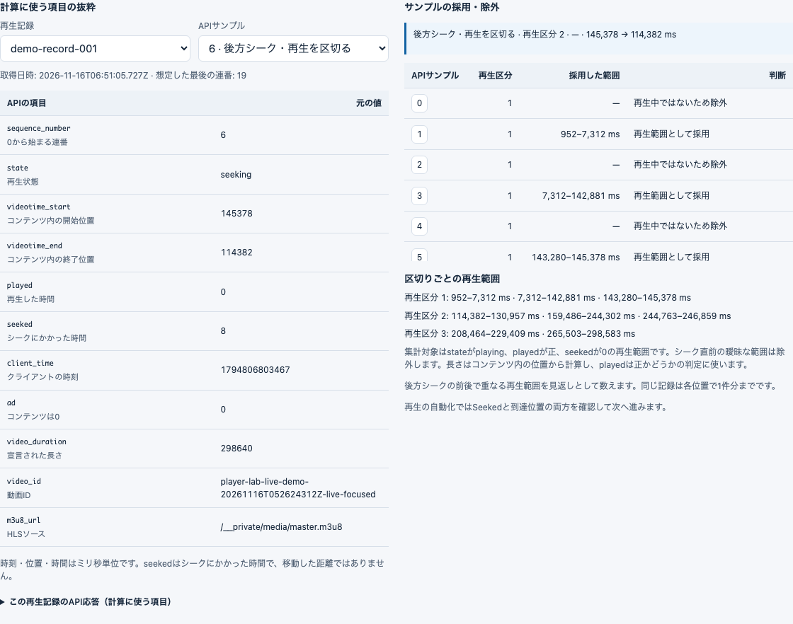
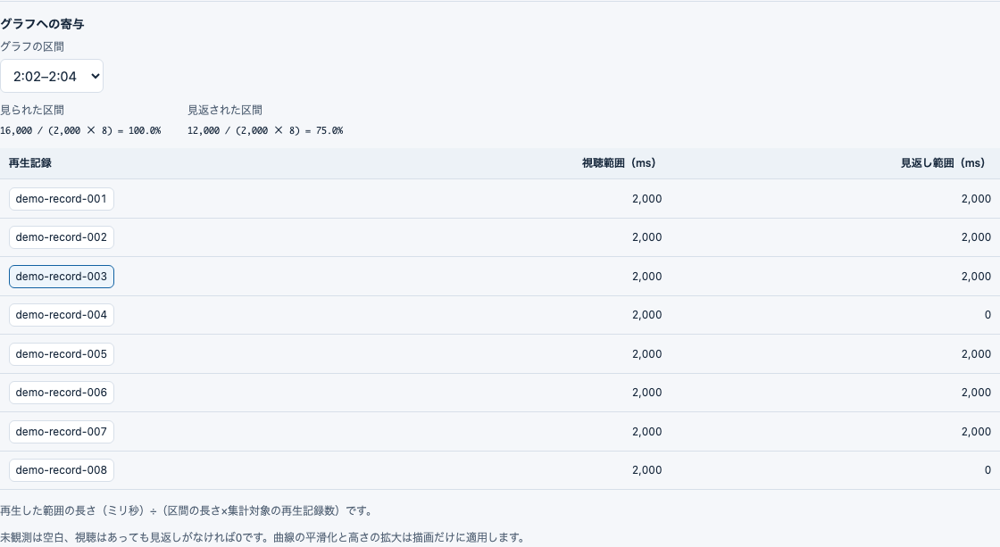

# Observabilityの再生記録から見返された区間を表示する

途中から参加したり、過去の場面へ戻ったりする視聴をデモ用に再現します。
Bitmovin PlayerとAnalytics Collectorで操作を収集し、Observability APIで取得した
再生記録をあらかじめ集計して表示します。映像はオンデマンドのHLSクリップで、
視聴行動はライブ配信を想定しています。

## 想定を分ける目的

選択肢は保存済みの再生記録と集計結果を切り替えるためのものです。
想定ごとに集計式や見返しの判定条件を変えているわけではありません。
同じ映像で視聴行動や記録数を変えたとき、結果をどう読むかを比較します。

| 視聴の想定 | 再生の操作 | 比較する点 |
| --- | --- | --- |
| 見返しが集中する | 同じ場面へ戻って再生する | 特定の場面に共通する見返しを確認する |
| 見返しが分散する | それぞれ異なる場面へ戻る | 見返す位置が揃わない場合と比較する |
| 視聴データが少ない | 少数の再生記録に巻き戻しが含まれる | 少数でも高い割合が出ることを確認する |

少数の記録でも曲線は描けます。ただし、高い割合だけでは幅広い視聴者に共通する傾向とは判断できません。
記録数は人の数ではなく、Analyticsのimpressionに対応する再生セッションの数です。
これらはデモ用に用意した操作の例であり、実際の視聴者を自動分類する機能ではありません。

初期表示は「見返された区間」です。
視聴の想定を切り替えても、動画は再生を続けます。
デモ下部の「視聴の想定と計算方法」から、この説明と計算のガイドを開けます。

## すべての想定に共通する計算

集計は[observed-replay.ts](../src/observed-replay.ts)が担当します。
入力は再生記録、対象コンテンツと集計期間、区間の幅です。想定の名前やIDは計算条件に含みません。
[main.ts](../src/main.ts)の`chooseProfile`は計算済みのデータを選ぶだけで、式を切り替えません。
この割合はPlayer Lab独自の指標であり、DashboardのEngagementの計算式を再現したものではありません。

1. 連番と内容を照合して同一サンプルの再送を除き、サンプルを送信順に並べます。
   連番の欠落や内容が異なる再送は、再生記録全体の検証エラーとします。
2. `playing`状態で`played > 0`、`seeked = 0`の妥当な再生範囲を採用します。
   シークで移動した距離や、シーク直前で位置が曖昧な範囲は加えません。
3. 後方シークの前後で再生を区切ります。この区切りを再生区分（pass）と呼び、同じ区分内で重なる範囲をまとめます。
   1回以上再生した範囲を視聴範囲、別の区切りで2回以上再生した範囲を見返し範囲とします。
4. 各範囲とグラフの区間が重なる長さを、再生記録ごとに求めて合計します。

区間の長さを`L`、採用した再生範囲がある記録の総数を`N`とすると、式は次のとおりです。
通常の区間は2,000msです。末尾が短い場合は、その区間の実際の長さを`L`に使います。

```text
見られた割合 = 各記録の視聴範囲と区間が重なる長さの合計 / (L × N)
見返された割合 = 各記録の見返し範囲と区間が重なる長さの合計 / (L × N)
```

`N`にはその区間には到達しなかった記録も含めます。起動だけで再生範囲がない記録は含めません。
`N = 0`の場合は割合を求めず、`null`を保ちます。
`support`は区間に到達した記録数であり、分母の`N`とは別の値です。
同じ記録で何度見返しても、各位置での寄与は1件分までです。
動画内の位置から長さを求めるため、低速再生だけでは値は増えません。
観測はあっても見返しがなければ`0`、区間に観測がなければ`null`です。

### 記録数と見返し位置を変えた計算例

いずれも2秒区間の例です。見返し範囲の合計が同じでも、分母の記録数で割合は変わります。

| 例 | N | 区間内の見返し範囲の合計 | 計算 |
| --- | --- | --- | --- |
| 集中する例 | 8 | 12,000ms | `12,000 / (2,000 × 8) = 75%` |
| 分散する例のある区間 | 8 | 2,000ms | `2,000 / (2,000 × 8) = 12.5%` |
| 記録が少ない例 | 4 | 6,000ms | `6,000 / (2,000 × 4) = 75%` |

「分散する例」は見返す位置が違うため、一つの区間では寄与が小さくなる場合があります。
「記録が少ない例」の75%は、8件の例の75%と同じ量の記録に裏付けられているわけではありません。
いずれも面白かった確率や統計的な信頼度を表す値ではありません。

区間の一部だけを見返した場合も、その長さだけを加えます。
例えば8件の記録のうち、ある2秒区間で1,618msと1,616msの見返しがあり、ほかの記録では0msなら、
`3,234 / (2,000 × 8) = 20.2125%`です。「2件が見返したから25%」という件数の割合とは異なります。
アプリでは区間を選ぶと、実際の入力に対する内訳と式を確認できます。

### 集計値と描画の違い

集計値は共通の式ですが、[描画処理](../src/timeline-geometry.ts)では記録数に応じて平滑化の強さを変えます。
これは曲線の表示を整えるための処理であり、少数データの統計的な信頼度を計算する処理ではありません。
元の割合を`r`、隣接区間との加重平均を`a`とすると、表示用の値`d`を次の式で求めます。

```text
alpha = 1 / (1 + sqrt(max(1, N)))
d = (1 - alpha) × r + alpha × a
```

両隣が観測済みの場合、`a = (左の値 + 2 × r + 右の値) / 4`です。
端では利用できる隣接区間だけを使い、未観測の区間をまたいで平均しません。
4件なら`alpha`は約0.333、8件なら約0.261となり、少ない記録ほど周囲の値へ少し寄せます。

カードの小グラフは共通の0〜100%スケールです。
映像上のグラフは、平滑化後の最大値が表示枠の高さになるよう拡大します。
そのため、元の最大値が12.5%の曲線と75%の曲線でも、映像上の山の高さは同じになり得ます。
想定間で割合を比べるときは「集計値」か「API応答と計算過程」の数値を使ってください。
これらは平滑化前の値であり、元の集計データは描画によって変更されません。
指標の定義と件数による集計との違いは[Analyticsデータの計算ガイド](analytics-data.ja.md#値の意味)にも記載しています。

## アプリでAPIの値と計算過程を見る

グラフ設定の横にある「API応答と計算過程」を開き、再生記録とグラフの区間を選びます。
一覧にはAPIから返されたサンプルを1行ずつ、元の順序で表示します。
`sequence_number`、`state`、`videotime_start`、`videotime_end`、`played`、`seeked`と、
そのサンプルを集計に使ったかどうかを確認できます。連番を選ぶと判断の理由を表示します。
選択区間に寄与した行には印が付き、下の集計へつながります。



集計欄では、サンプルの連番と再生区分、その区間内の視聴範囲と見返し範囲、
選択記録が寄与したミリ秒数を順に確認できます。その下に全記録の合計を使った式を表示します。
足すのはコンテンツ上の範囲の長さで、実時間の`played`ではありません。



記録別の内訳とAPI応答のJSONは、詳細を開くと確認できます。JSONは計算に使う項目の抜粋で、
元の項目名、値、順序、同一サンプルの再送を保持します。認証情報やユーザー情報は含みません。
記録の選択肢はこのデモの表示用IDであり、APIの再生IDではありません。
再生記録、区間、言語を切り替えても動画の再生は続きます。

計算欄とsnapshotは同じ集計処理を使います。採用・除外の判断や終端の調整をしても、元のAPIの値は変更しません。

## 再生記録を収集してDashboardで確認する

デモ専用のAnalyticsライセンスを使います。収集用のPlayerに次の項目を設定すると、
デモの記録を絞り込めます。CollectorとQueryには同じ値を指定してください。

```ts
analytics: {
  key: "<DEMO_ANALYTICS_LICENSE_KEY>",
  config: { cookiesEnabled: false },
  videoId: "player-lab-live-demo-<RUN_ID>-<SCENARIO>",
  title: "Player Lab rewatching demo",
  customData1: "player-lab-observability-demo",
  customData2: "<SCENARIO>",
  customData3: "<RUN_ID>",
}
```

Bitmovin Dashboardでそのライセンスと収集した時間帯を選びます。
動画ID、デモを示す`customData1`、収集単位を示す`customData3`で絞り込み、
再生記録の詳細を開くと再生区間やシークを確認できます。
項目とフィルターの設定は公式の[Collector設定](https://developer.bitmovin.com/playback/docs/configuration-analytics)を参照してください。

再生操作を自動化するときは`PlayerEvent.Seeked`を待ち、Playerの現在位置が
シーク先に到達したことを確認してから次の操作へ進みます。
データ収集では再生速度を上げています。起動時間やシーク時間などの性能評価には使いません。
このリファレンスの表示画面ではAnalyticsへの送信を無効にしています。

## サーバーで再生記録を取得する

Query APIで再生IDを探し、Impression Detailsで詳細を取得して再生区間を集計します。
その結果を保存し、ブラウザーへ配信します。アカウントのAPIキーはサーバー側で管理してください。
以下はサーバー側のスクリプトを作るためのリクエスト例です。
このアプリには汎用のAnalytics取得コマンドは含まれていません。

`POST https://api.bitmovin.com/v1/analytics/queries/count`に、
`X-Api-Key: <SERVER_API_KEY>`ヘッダーと次のJSONを送ります。

```json
{
  "licenseKey": "<DEMO_ANALYTICS_LICENSE_KEY>",
  "start": "2026-01-01T00:00:00.000Z",
  "end": "2026-01-01T00:10:00.000Z",
  "dimension": "IMPRESSION_ID",
  "groupBy": ["IMPRESSION_ID", "VIDEO_ID"],
  "filters": [
    { "name": "VIDEO_ID", "operator": "CONTAINS", "value": "player-lab-live-demo-<RUN_ID>-" },
    { "name": "CUSTOM_DATA_3", "operator": "EQ", "value": "<RUN_ID>" },
    { "name": "AD", "operator": "EQ", "value": 0 }
  ],
  "limit": 100,
  "offset": 0
}
```

時間帯は実際に収集した範囲へ変更します。応答の列は`columnLabels`のキーで特定し、
続きの行がある場合は`offset`を変えて取得します。想定した再生IDと動画IDが
すべて含まれることを確認してください。件数を取得できても、各再生のサンプルが
最後まで到着しているとは限りません。ページ分割の項目と1ページの上限は
公式の[Queryリクエストの定義](https://bitmovin.github.io/bitmovin-api-sdk-javascript/classes/AnalyticsQueryRequest.html)を参照してください。

対象の再生ごとに、`POST https://api.bitmovin.com/v1/analytics/impressions/<IMPRESSION_ID>`へ
同じAPIキーヘッダーとJSON `{"licenseKey":"<DEMO_ANALYTICS_LICENSE_KEY>"}`を送ります。
成功応答の`data.result`がサンプルの配列であることを確認します。
変換前に`impression_id`、`video_id`、デモ用の項目、ソースURL、`ad`が
収集時の想定と一致することを確かめてください。

応答の項目名はスネークケースです。次の項目だけを
[`ObservedSample`](../src/observed-replay.ts)へ対応させます。

| API応答の項目 | 集計入力の項目 | 意味 |
| --- | --- | --- |
| `sequence_number` | `sequenceNumber` | 0から始まるサンプルの連番 |
| `client_time` | `clientTime` | クライアントの時刻。ミリ秒単位 |
| `state` | `state` | 収集された再生状態 |
| `ad` | `ad` | コンテンツ再生は`0` |
| `played` | `played` | 再生した時間。ミリ秒単位 |
| `seeked` | `seeked` | シークにかかった時間。ミリ秒単位 |
| `videotime_start` | `videotimeStart` | コンテンツ内の開始位置。ミリ秒単位 |
| `videotime_end` | `videotimeEnd` | コンテンツ内の終了位置。ミリ秒単位 |
| `video_duration` | `videoDuration` | コンテンツの長さ。ミリ秒単位 |
| `video_id` | `videoId` | 収集された動画ID |
| `m3u8_url` | `sourceUrl` | 収集されたHLSのソースURL |

`seeked`はシークにかかった時間です。移動した距離や巻き戻し回数ではありません。
時間の項目は公式の[サンプル項目リファレンス](https://bitmovin.github.io/bitmovin-api-sdk-php/classes/BitmovinApiSdk_Models_AnalyticsImpressionSample.html)で確認できます。
ユーザー、ネットワーク、ライセンスの情報を集計入力やブラウザー用のデータに含めないでください。

## 集計したグラフを保存する

集計はブラウザーの外で実行します。Node.js 24.xの24.19以降が必要です。
次の例では、`rawSamples`が検証済みのImpression Detailsの配列、
`capturedFinalSequence`が収集終了時に記録した最後の連番です。
最後の連番は別に記録してください。APIから返った連番の最大値だけでは、
末尾のサンプルが欠けているかどうかを判別できません。

```js
import { computeObservedReplay } from "../src/observed-replay.ts";
import { validatePrivateData } from "../src/private-data.ts";

const projectSample = row => ({
  sequenceNumber: row.sequence_number, clientTime: row.client_time,
  state: row.state, ad: row.ad, played: row.played, seeked: row.seeked,
  videotimeStart: row.videotime_start, videotimeEnd: row.videotime_end,
  videoDuration: row.video_duration, videoId: row.video_id,
  sourceUrl: row.m3u8_url,
});
const snapshot = computeObservedReplay({
  content: { id: "demo-clip", revision: "demo-v1", durationMs: 60_000 },
  period: {
    start: "2026-01-01T00:00:00.000Z",
    end: "2026-01-01T00:10:00.000Z",
  },
  videoId: "player-lab-live-demo-<RUN_ID>-<SCENARIO>",
  sourceUrl: "/__private/media/master.m3u8",
  sessions: [{
    id: "demo-record-1",
    expectedLastSequence: capturedFinalSequence,
    samples: rawSamples.map(projectSample),
  }],
}, 2_000);

const pack = {
  schemaVersion: 1,
  kind: "observability-replay-demo",
  source: { hls: "/__private/media/master.m3u8" },
  profiles: [{
    id: "focused",
    title: { en: "Concentrated rewatching", ja: "見返しが集中する" },
    snapshot,
  }],
};
validatePrivateData(pack);
```

長さ、ソース、動画ID、時間帯を収集したクリップに合わせます。
完全な再生記録を視聴の想定ごとに分けて集計すると、選択肢を追加できます。
選択肢の間でコンテンツのリビジョン、長さ、時間帯、生成時刻を揃えてください。
検証処理は連番の欠落、内容が異なる再送、コンテンツの不一致、
シークを伴わない不明な再生位置の逆行を拒否します。

検証に使ったクリップには、APIの`video_duration`を5ミリ秒超える終了位置のサンプルがありました。
独立した計測では、再生完了後の`HTMLMediaElement.duration`もSDKが返す長さを超えていました。
この差を扱うため、次の条件に限って終端を許容します。
`mediaDurationMs`には、独立に計測して小数点以下を切り捨てたミリ秒値を任意で渡せます。
値は宣言した長さ以上、その5ミリ秒先までの範囲です。想定した最後の連番に限り、
終了位置がこの計測値以内なら扱えます。`playing`状態で`played`が正、`seeked`が0、
開始位置が宣言した終端より前であることも条件です。
集計範囲は宣言した長さまでに制限し、元の値は変更しません。
計測した長さを渡さない場合は、宣言した長さを超える位置を拒否します。
詳細な条件は[`computeObservedReplay`](../src/observed-replay.ts)を参照してください。

`JSON.stringify(pack)`をチェックアウト外へ保存し、ファイルの読み取り権限を制限します。
`PLAYER_UI_PRIVATE_QUERY_FILE`にそのファイルを指定し、
[ローカル再生の手順](private-query-data.ja.md#ダウンロードしたhlsを再生する)に従ってHLSのディレクトリを設定します。
`/?data=private`を開くと「Observability API · デモ視聴データ」と表示されます。
視聴の想定を選び、見返しと視聴範囲のグラフを切り替えられます。

実際のサービスではコンテンツ管理システム（CMS）へコンテンツのリビジョンごとに
集計結果を保存し、動画と一緒に配信できます。ブラウザーに必要なのは集計済みのデータです。
アカウントのAPIキーや再生ごとのAnalytics Queryは必要ありません。
集計結果は`metricVersion: "observed-replay-coverage-v1"`、`synthetic: false`となり、
[`validatePrivateData`](../src/private-data.ts)もこの区別を保ちます。

### API応答の抜粋を確認用に含める

観測したデータの視聴パターン（profile）に任意の確認用データ`evidence`を追加します。
項目名を集計用に変換する前に、APIのサンプルを保持してください。
次の`apiFetchedAt`はAPI応答を受け取った時点のUTC時刻で、
`capturedFinalSequence`は別途保存した収集終了時の連番です。

```js
const apiFields = [
  "sequence_number", "client_time", "state", "ad", "played", "seeked",
  "videotime_start", "videotime_end", "video_duration", "video_id", "m3u8_url",
];
const evidence = {
  schemaVersion: 1,
  videoId: "player-lab-live-demo-<RUN_ID>-<SCENARIO>",
  sourceUrl: "/__private/media/master.m3u8",
  sessions: [{
    id: "demo-record-1",
    expectedLastSequence: capturedFinalSequence,
    fetchedAt: apiFetchedAt,
    response: {
      status: "SUCCESS",
      data: { result: rawSamples.map(row =>
        Object.fromEntries(apiFields.map(field => [field, row[field]]))) },
    },
  }],
};
pack.profiles[0].evidence = evidence;
validatePrivateData(pack);
```

複数の再生記録を集計した場合は、そのprofileのsnapshotに使った記録をすべて含めます。
集計で`mediaDurationMs`を使った場合は、同じ実測値を`evidence`にも指定してください。
検証処理は抜粋から再集計し、snapshotと一致しなければ拒否します。
集計用に変換したデータからAPIのサンプルを逆生成しないでください。
項目の定義は[確認用データの型](../src/observed-evidence.ts)を参照してください。

確認用データもチェックアウト外のローカルJSONに保存し、既存の512KiBの応答上限を守ります。
グラフだけを表示する実装では、従来どおり集計済みsnapshotだけを配信できます。
確認画面を開いても、アカウントAPIへの要求は発生しません。

## グラフが示すもの

同じ再生記録で何度見返しても、各位置で1件分を超えて数えることはありません。
未観測は`null`のまま残し、視聴はあるものの見返しがない区間は見返しを`0`とします。
少ない記録からでもグラフを描けますが、視聴者全体の好みを示すものとは限りません。

これはPlayer Lab独自の指標です。Bitmovin DashboardのEngagementグラフとは定義が異なります。
Query APIの件数だけでは同じ記録内の再生の重なりを復元できないため、
[Queryのみの表示](private-query-data.ja.md)では見返しを利用できません。

Analyticsに接続せずに試す場合は、[`createLiveDemoScenarios`](../tools/live-demo.ts)で
オフライン用の視聴記録を生成できます。この別の経路では`kind: "synthetic-live-demo"`、
`synthetic: true`を使い、画面にも仮想データと表示します。
