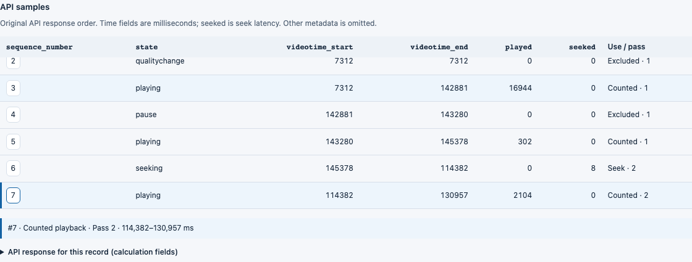
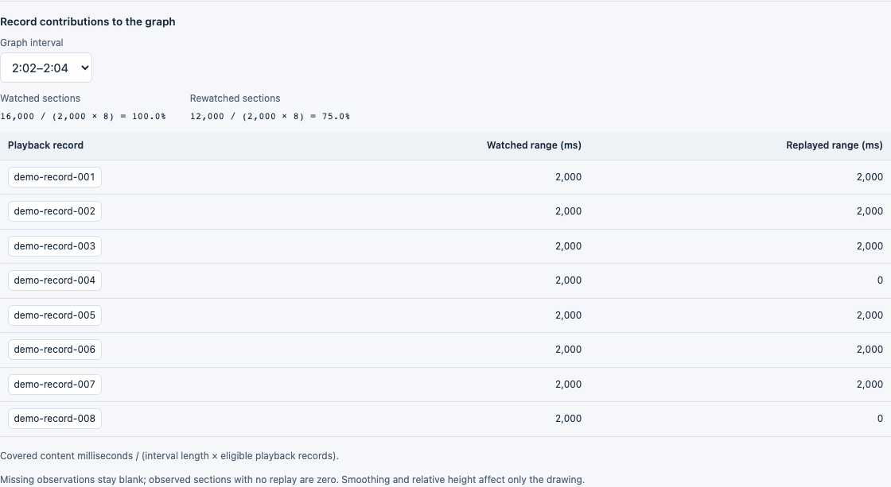

# Rewatching from Observability playback records

This demo stages an audience that joins at different positions, rewinds and resumes
playback. Bitmovin Player and its Analytics collector produce the records. The
records are retrieved through the Observability APIs and aggregated before the
page loads. The media is an on-demand HLS clip; live-style viewing is the demo
scenario.

| Scenario | Playback pattern | Graph |
| --- | --- | --- |
| Concentrated rewatching | Records include returns to the same moments | Localized peaks |
| Distributed rewatching | Records include returns to different moments | Lower peaks across a wider area |
| A small audience | A few records include returns to earlier moments | Replay remains visible with a small sample count |

Rewatching is selected initially. The previews share a 0–100% scale; the overlay
expands its highest value to make the shape visible. Changing the scenario
updates the graph while the video keeps playing.

## Inspect the API values and calculation in the app

Choose **API response and calculation** beside the graph controls. Select a playback
record to see the original `sequence_number`, `state`, `videotime_start`,
`videotime_end`, `played` and `seeked` values. The JSON view retains the original
API field names and values for the fields used by the calculation. It is an excerpt;
authentication, user and unrelated metadata are excluded.

Each sequence shows whether its interval was counted, separated by a seek or
excluded. A counted sample must have `state: "playing"`, positive `played`,
zero `seeked` and a positive content range. A backwards seek starts another pass through the content. Only the
overlap of actual played intervals across passes becomes rewatched coverage.
Fragments within the same pass are unioned before comparing passes; watched
coverage is the union of the record's counted intervals.
Ambiguous intervals immediately before a seek are excluded; the raw sample
remains visible. A terminal-duration adjustment also leaves the raw value intact.



Select a graph interval to inspect each playback record's contributing watched
and rewatched milliseconds. The displayed formula adds those contributions and
divides by interval length × eligible record count. For example, 12,000 rewatched
milliseconds in a 2,000 ms interval across eight records gives
`12,000 / (2,000 × 8) = 75%`. These are content-timeline lengths, not elapsed
wall-clock `played` durations. Missing observations remain missing.
The eligible count includes records with counted content coverage; startup-only
records without a played range do not enter the denominator.
Record selectors use local display IDs. The table and JSON show the retained
API fields, rather than treating those display IDs as returned impression IDs.



The calculation view uses the same [aggregation implementation](../src/observed-replay.ts)
as the snapshot. The curve applies bounded smoothing for display; the video overlay
scales heights to the distribution's maximum. Neither changes the table's raw
coverage percentages. Changing the record, interval or language keeps playback running.

## Collect records and find them in Dashboard

Use a dedicated demo Analytics license. A collection Player can use the following
metadata to keep demo records identifiable. Replace the placeholders consistently
in the collector and the queries:

```ts
analytics: {
  key: "<DEMO_ANALYTICS_LICENSE_KEY>",
  config: { cookiesEnabled: false },
  videoId: "player-lab-live-demo-<RUN_ID>-<SCENARIO>",
  title: "Player Lab rewatching demo",
  customData1: "player-lab-observability-demo",
  customData2: "<SCENARIO>",
  customData3: "<RUN_ID>",
}
```

In Bitmovin Dashboard, select that license and the collection time range. Filter
by the video ID, `customData1` demo marker or `customData3` run marker, then open
an impression's details to inspect playback intervals and seeks. See the official
[collector configuration](https://developer.bitmovin.com/playback/docs/configuration-analytics)
for metadata and filter settings.

When automating playback, wait for `PlayerEvent.Seeked` and confirm that the
Player's current position has reached the target before continuing. Accelerated
playback shortens data collection; its startup and seek timings are not playback
quality or performance benchmarks. The reference page itself keeps Analytics
collection disabled.

## Retrieve records on the server

The pipeline is Query API discovery → Impression Details → interval aggregation
→ saved snapshot → browser. Keep the account API key on the server. The examples
below describe requests to adapt in a server-side script; this app does not ship
a general-purpose Analytics fetch command.

Discover the demo impressions with `POST https://api.bitmovin.com/v1/analytics/queries/count`,
an `X-Api-Key: <SERVER_API_KEY>` header and this JSON body:

```json
{
  "licenseKey": "<DEMO_ANALYTICS_LICENSE_KEY>",
  "start": "2026-01-01T00:00:00.000Z",
  "end": "2026-01-01T00:10:00.000Z",
  "dimension": "IMPRESSION_ID",
  "groupBy": ["IMPRESSION_ID", "VIDEO_ID"],
  "filters": [
    { "name": "VIDEO_ID", "operator": "CONTAINS", "value": "player-lab-live-demo-<RUN_ID>-" },
    { "name": "CUSTOM_DATA_3", "operator": "EQ", "value": "<RUN_ID>" },
    { "name": "AD", "operator": "EQ", "value": 0 }
  ],
  "limit": 100,
  "offset": 0
}
```

Use the actual collection time range. Resolve result columns by their
`columnLabels` keys, and paginate with `offset` if more rows exist. Check all
expected impression IDs and video IDs; a successful count query alone does not
prove that every playback sample has arrived. The official
[Query request model](https://bitmovin.github.io/bitmovin-api-sdk-javascript/classes/AnalyticsQueryRequest.html)
documents the pagination fields and maximum page size.

For each selected impression, request
`POST https://api.bitmovin.com/v1/analytics/impressions/<IMPRESSION_ID>` with the
same API-key header and `{"licenseKey":"<DEMO_ANALYTICS_LICENSE_KEY>"}` as the JSON
body. Require a successful response and its `data.result` sample array. Check
`impression_id`, `video_id`, demo markers, source URL and `ad` against the expected
collection scope before projecting samples.

The raw response uses snake-case names. Map only these fields into
[`ObservedSample`](../src/observed-replay.ts):

| Raw API field | Aggregation field | Meaning |
| --- | --- | --- |
| `sequence_number` | `sequenceNumber` | Zero-based sample sequence |
| `client_time` | `clientTime` | Client timestamp in milliseconds |
| `state` | `state` | Collected playback state |
| `ad` | `ad` | `0` for content playback |
| `played` | `played` | Playback time in milliseconds |
| `seeked` | `seeked` | Time spent seeking in milliseconds |
| `videotime_start` | `videotimeStart` | Start position in the content, in milliseconds |
| `videotime_end` | `videotimeEnd` | End position in the content, in milliseconds |
| `video_duration` | `videoDuration` | Content duration in milliseconds |
| `video_id` | `videoId` | Collected video identifier |
| `m3u8_url` | `sourceUrl` | Collected HLS source URL |

`seeked` is seek latency, not the distance moved or the number of rewinds. The
[official sample field reference](https://bitmovin.github.io/bitmovin-api-sdk-php/classes/BitmovinApiSdk_Models_AnalyticsImpressionSample.html)
defines the time fields. Do not copy user, network or license metadata into the
aggregation input or the browser snapshot.

## Aggregate once and save the graph

Run the aggregation outside the browser using Node.js 24.x, version 24.19 or
later. In this example, `rawSamples` is the validated Impression Details array;
`capturedFinalSequence` is the last sequence number recorded when collection
closed. Capture that boundary separately: taking the maximum sequence returned
by the API cannot detect a missing tail.

```js
import { computeObservedReplay } from "../src/observed-replay.ts";
import { validatePrivateData } from "../src/private-data.ts";

const projectSample = row => ({
  sequenceNumber: row.sequence_number, clientTime: row.client_time,
  state: row.state, ad: row.ad, played: row.played, seeked: row.seeked,
  videotimeStart: row.videotime_start, videotimeEnd: row.videotime_end,
  videoDuration: row.video_duration, videoId: row.video_id,
  sourceUrl: row.m3u8_url,
});
const snapshot = computeObservedReplay({
  content: { id: "demo-clip", revision: "demo-v1", durationMs: 60_000 },
  period: {
    start: "2026-01-01T00:00:00.000Z",
    end: "2026-01-01T00:10:00.000Z",
  },
  videoId: "player-lab-live-demo-<RUN_ID>-<SCENARIO>",
  sourceUrl: "/__private/media/master.m3u8",
  sessions: [{
    id: "demo-record-1",
    expectedLastSequence: capturedFinalSequence,
    samples: rawSamples.map(projectSample),
  }],
}, 2_000);

const pack = {
  schemaVersion: 1,
  kind: "observability-replay-demo",
  source: { hls: "/__private/media/master.m3u8" },
  profiles: [{
    id: "focused",
    title: { en: "Concentrated rewatching", ja: "見返しが集中する" },
    snapshot,
  }],
};
validatePrivateData(pack);
```

Set the duration, source, video identity and period to match the collected clip.
Group complete records by scenario and aggregate each group to add profiles;
profiles must share the content revision, duration, period and generation time.
The validator rejects missing sequence numbers, conflicting retries, mismatched
content and ambiguous backwards movements without a seek.

The tested clip produced a sample ending 5 ms past the API's `video_duration`.
An independent check also found that the final `HTMLMediaElement.duration`
exceeded the SDK's reported duration.
The following narrow rule covers that observed difference.
Optional `mediaDurationMs` is an independently measured duration rounded down to
integer milliseconds. It must be between the declared duration and 5 ms beyond
it. Only the expected final sequence in `playing` state, with positive `played`,
zero `seeked` and a start before the declared end, may reach that measured limit.
Coverage is intersected with the declared timeline; raw values remain unchanged.
Without that evidence, the declared duration is a strict bound.
See [`computeObservedReplay`](../src/observed-replay.ts) for the exact checks.

Save `JSON.stringify(pack)` outside the checkout with private file permissions.
Set `PLAYER_UI_PRIVATE_QUERY_FILE` to that file and configure the HLS directory
using [local playback](private-query-data.md#play-a-downloaded-hls-package).
Open `/?data=private`; the badge reads “Demo viewing data · Observability API”.
Both graph options and the scenario selector are enabled.

A production integration can store the aggregate in a content management system
(CMS), keyed by content revision, and serve it with the video. The browser needs
the snapshot, not an account API key or a new Analytics query for every play.
The observed snapshot has `metricVersion: "observed-replay-coverage-v1"` and
`synthetic: false`; [`validatePrivateData`](../src/private-data.ts) preserves that
origin.

### Include the API excerpt for inspection

To make the values inspectable, add an optional `evidence` field to an observed
profile. Keep the original API samples before converting their property names.
`apiFetchedAt` below is the UTC timestamp recorded when the API response arrived;
`capturedFinalSequence` still comes from the separate collection receipt.

```js
const apiFields = [
  "sequence_number", "client_time", "state", "ad", "played", "seeked",
  "videotime_start", "videotime_end", "video_duration", "video_id", "m3u8_url",
];
const evidence = {
  schemaVersion: 1,
  videoId: "player-lab-live-demo-<RUN_ID>-<SCENARIO>",
  sourceUrl: "/__private/media/master.m3u8",
  sessions: [{
    id: "demo-record-1",
    expectedLastSequence: capturedFinalSequence,
    fetchedAt: apiFetchedAt,
    response: {
      status: "SUCCESS",
      data: { result: rawSamples.map(row =>
        Object.fromEntries(apiFields.map(field => [field, row[field]]))) },
    },
  }],
};
pack.profiles[0].evidence = evidence;
validatePrivateData(pack);
```

For multiple records, include every record used by that profile's snapshot. If
aggregation used `mediaDurationMs`, include the same independently measured value
in `evidence`. Validation recomputes the graph from the excerpt and rejects a
mismatched snapshot. Do not recreate API samples from the already normalized
aggregation input. See [the evidence contract](../src/observed-evidence.ts).

The evidence stays in the external local JSON file, subject to the existing
512 KiB response limit. Graph-only integrations can continue to send the compact
snapshot without this inspection data. Opening the inspector makes no account API request.

## What the graph means

Repeated replays by one record contribute at most one record's coverage at each
position. Missing observations stay `null`; observed intervals with no replay
have replay `0`. A small sample can draw a curve, but does not establish what the
wider audience prefers.

This is a Player Lab metric. Bitmovin Dashboard's built-in Engagement graph uses
a different definition. Query API counts alone cannot reconstruct overlap within
a record; the [Query-only mode](private-query-data.md) therefore leaves replay
unavailable.

For an entirely offline fixture, [`createLiveDemoScenarios`](../tools/live-demo.ts)
authors viewing records without contacting Analytics. That separate path uses
`kind: "synthetic-live-demo"` and `synthetic: true`, and is labeled as simulated
data in the UI.
