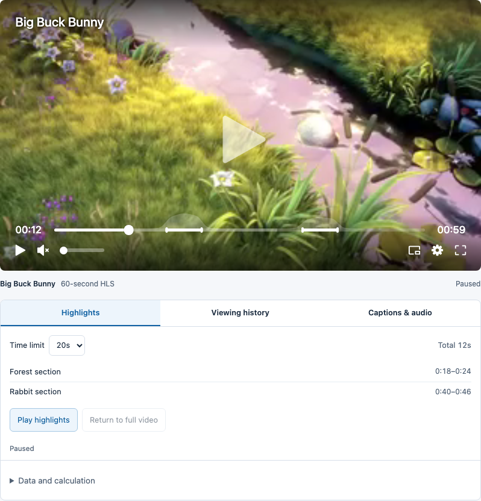
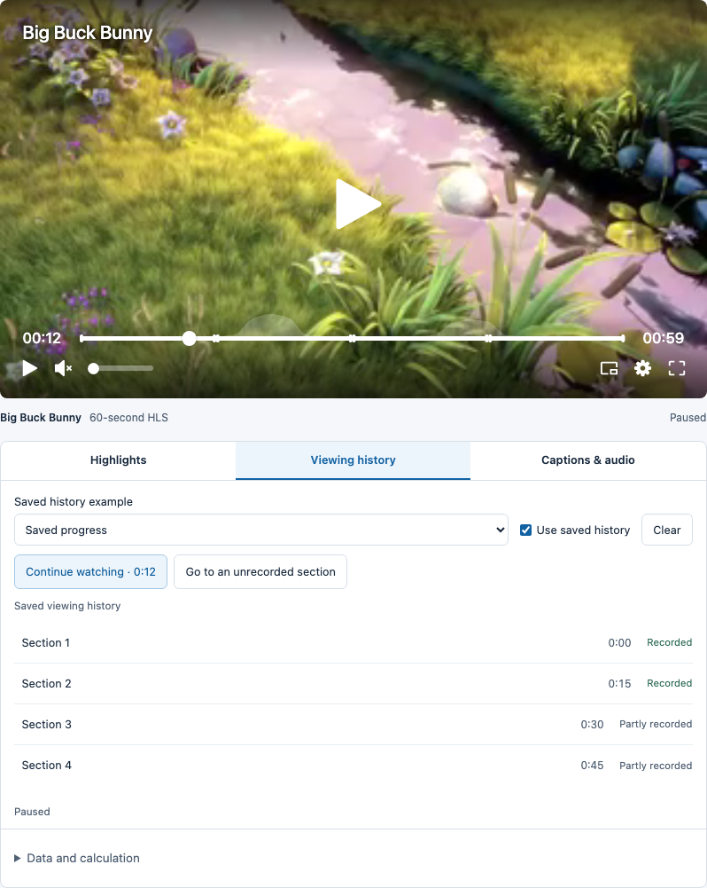
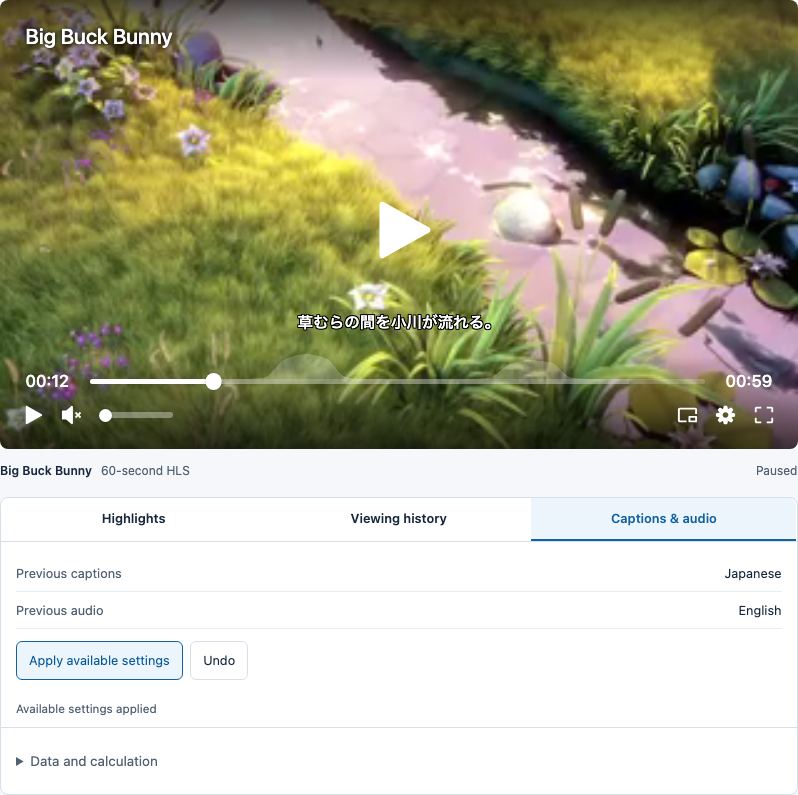

# Highlights, saved history, and previous settings

[English](viewer-experiences.md) · [日本語](viewer-experiences.ja.md) · [Run the reference](../README.md#run-locally)

These tools sit below the video and complement the official Player controls.
The default 60-second Big Buck Bunny example uses synthetic saved history and
editor-defined sections. Current playback does not update that history or send
Analytics events. No Analytics license or account API key is needed.

## Play a short selection

When you have little time, open **Highlights**, choose a **Time limit**, and
review the listed sections. **Play highlights** plays those sections in content
order using the same Player and video element. A 20-second limit is a ceiling;
the default `sparse` dataset selects two sections totaling 12 seconds.

**Return to full video** stops automatic jumps at the current position. A manual
seek also cancels the queue. Playback pauses after the final selected section.
Changing the dataset or time limit cancels an active queue. Source changes, ads,
casting, errors, and disposal also cancel automatic movement.



The candidate boundaries and titles come from a content management system (CMS)
fixture. Analytics ranks
those candidates by rewatch coverage; it does not identify editorial highlights
or prove that a scene is important.

## Continue from a saved visit

Open **Viewing history** and choose **Saved progress**. **Continue watching**
starts at 0:12, the latest recorded playback endpoint. An earlier visit reached
0:46; the furthest position does not determine the resume point.

**Next unrecorded section** starts at 0:32. Chapter rows show **Recorded**,
**Partly recorded**, **No record**, or **Unknown**, and their buttons start at the
chapter boundary. **Partial history** retains known watched ranges but disables
the next-unrecorded action because missing history is unknown.



Try **First visit**, **Completed viewing**, and **History unavailable** to compare
their states. Turning off **Use saved history** disables history-based actions.
**Clear** removes the selected example from the current view; choosing an example
loads it again. These controls do not delete a server record or save new progress.

## Reuse previous captions and audio

With **Saved progress** selected, open **Captions & audio** and choose
**Apply available settings**. The example requests Japanese captions and English
audio. The Player changes only settings supported by the current source.
**Undo** restores the settings captured immediately before applying them.



**Captions were off** explicitly disables captions. **Settings not recorded**
leaves both settings unknown. A missing language is displayed as unavailable and
is not replaced with an invented track. Changing the history or source invalidates
the old undo state.

The English and Japanese WebVTT tracks are original visual descriptions for this
reference, not dialogue transcriptions or translations. The source has an English
audio track; the example does not add multilingual audio.

## Which component does what?

| Part | Responsibility |
| --- | --- |
| Official `UIFactory` layouts and `SeekBar` | Playback controls, settings, and ordinary seeking |
| Official `UIManager.timelineMarkers` | Draw CMS section/chapter ranges and labels on the seek bar |
| Official `SubtitleOverlay`, `SubtitleSelectBox`, `AudioTrackSelectBox` | Render captions and reflect available/selected tracks |
| [viewer-data.ts](../src/viewer-data.ts) | Validate inputs; select highlights; derive history, settings, and chapter progress |
| [viewer-playback.ts](../src/viewer-playback.ts) | Seek/play an opted-in queue; apply/undo supported settings; cancel stale operations |
| [viewer-experience-view.ts](../src/viewer-experience-view.ts) | Tabs, example selection, action buttons, state, and data details |
| [viewer-markers.ts](../src/viewer-markers.ts) | Convert milliseconds to official marker seconds; replace only reference-owned markers |
| [viewer-fixtures.ts](../src/viewer-fixtures.ts) | Authored CMS boundaries and independent synthetic history examples |

[create-player-ui.ts](../src/create-player-ui.ts) decorates the official layouts;
the standard seek bar remains responsible for seeking. The tab selection changes
which markers are shown without changing the graph's underlying values.
See the pinned [official UI configuration](https://github.com/bitmovin/bitmovin-player-ui/blob/v4.23.1/src/ts/UIConfig.ts)
and [audio](https://github.com/bitmovin/bitmovin-player-ui/blob/v4.23.1/src/ts/components/settings/AudioTrackSelectBox.ts)/[subtitle](https://github.com/bitmovin/bitmovin-player-ui/blob/v4.23.1/src/ts/components/settings/SubtitleSelectBox.ts) components.

## Where the reference values come from

| Type | Contents |
| --- | --- |
| `ViewerCatalog`, `ViewerSection` | Content ID, video revision and duration; authored chapters/clips with localized titles and millisecond boundaries |
| `ViewerHistoryInput`, `ViewerHistorySample` | Saved-history scope, `asOf`, completeness, original sample receipts, and optional track fields |
| `ViewerHistory` | Merged watched ranges, permitted complement, resume position, previous settings, and availability state |

`startMs` and `endMs` are content positions in milliseconds.

`selectHighlights(snapshot, catalog, budgetMs)` accepts synthetic or observed
replay-coverage snapshots for the exact catalog content ID, revision, and duration.
Query-only incidence cannot supply replay. For each CMS clip:

```text
score = sum(overlapMs(clip, bucket) × bucket.replay) / clipDurationMs
```

Every intersecting bucket must have observed support and a non-null replay value.
Positive scores are ranked; overlapping candidates and clips that exceed the
remaining budget are skipped. Selected clips are then sorted into content order.
The returned `HighlightQueue.scores` records each decision and minimum support.
Support is the number of records with watched coverage in a bucket; the table
uses the smallest support among a candidate's buckets.

| Default `sparse` candidate | Calculation | Score | Minimum support | Result with 20s limit |
| --- | --- | --- | --- | --- |
| 18–24s | `(2000×0.65 + 2000×0.8 + 2000×0.7) / 6000` | About 71.7% | 5 | Selected |
| 40–46s | `(2000×0.5 + 2000×0.6 + 2000×0.55) / 6000` | 55% | 3 | Selected |
| 28–34s | All intersecting replay values are 0 | 0 | 4 | No replay |

`deriveViewerHistory(input)` validates original `sequence_number` receipts and
deduplicates identical retries before excluding ad packets. An internal non-ad
projection maps `client_time`, `state`, `played`, `seeked`, `videotime_start`, and
`videotime_end` into [the canonical observed-replay inspection](../src/observed-replay.ts).
Original sample values remain unchanged; internal projection ordinals are not raw
API sequence numbers. Only canonical counted ranges contribute to personal history.

The saved example unions those ranges across visits into `[0,32000]` and
`[40000,46000]` milliseconds: **38 seconds recorded**. Its latest valid played
sample covers 8–12s, so `resumeMs` is `12000`. With complete history, the complement
is `[32000,40000]` and `[46000,60000]`. `chapterProgress(history, catalog)` intersects
the four 15-second chapters with the union, yielding 15s, 15s, 7s, and 1s recorded.

Settings use the latest non-ad sample carrying actual `audio_language`,
`subtitle_enabled`, or `subtitle_language` values. `ViewerPreferences` uses
`string | null`, `boolean | null`, and `string | null` respectively. `false` means
captions were off; `null` means unavailable. Browser `language` is not a track
preference. Export strings need explicit adapter conversion; `Boolean("false")`
would incorrectly produce `true`. Conflicting visits with equal latest client
clocks leave the position/settings unknown. Demo clocks are authored to be
comparable; cross-device clock skew can invalidate that ordering. A production
backend must establish a trustworthy ordering policy and abstain from resume or
setting restoration when the order is unknown.

The public [Analytics fields](https://developer.bitmovin.com/playback/docs/analytics-api-fields)
and [impression sample model](https://bitmovin.github.io/bitmovin-api-sdk-python/_modules/bitmovin_api_sdk/models/analytics_impression_sample.html)
describe these source fields. For retrieval, units, and replay formulas, use
[Calculation and Analytics data](analytics-data.md) and the
[Observability demo guide](live-demo-data.md).

## Connect the helpers

These callbacks illustrate the existing default-demo integration after its
matching source is ready. Bind each callback to an explicit button. `playback`
comes from `createPlayback`; `snapshot` is the validated snapshot for that source,
and `locale` is the selected `"en"` or `"ja"` UI language.

```ts
import { deriveViewerHistory, selectHighlights } from "./src/viewer-data.ts";
import { VIEWER_CATALOG, VIEWER_HISTORY_EXAMPLES } from "./src/viewer-fixtures.ts";

const queue = selectHighlights(snapshot, VIEWER_CATALOG, 20_000);
const history = deriveViewerHistory(VIEWER_HISTORY_EXAMPLES[0].input);
playback.ui.setViewerMarkers(queue.items.map(clip => ({
  id: clip.id, startMs: clip.startMs, endMs: clip.endMs, title: clip.title[locale],
})));
playback.viewer.offerPreferences(history.preferences);
const playHighlights = () => queue.status === "ready"
  ? playback.viewer.startHighlights(queue.items) : Promise.resolve(false);
const stopHighlights = () => playback.viewer.stopHighlights();
const continueWatching = () => history.resumeMs !== null && history.status !== "completed"
  ? playback.viewer.playFrom(history.resumeMs) : Promise.resolve(false);
const applySettings = () => playback.viewer.restorePreferences(history.preferences);
const undoSettings = () => playback.viewer.undoPreferences();
```

The complete wiring is in [main.ts](../src/main.ts) and the view module. A new
application must gate actions on the loaded content identity, refresh offered
preferences on history changes, and release the controller with the Player.

For production, publish versioned aggregate snapshots and authored sections from
your CMS. Deliver personal history separately through a backend that authorizes
the current viewer. Keep account API keys, subscriber IDs, and other viewers'
raw records out of browser-facing data. The demo does not implement that backend.

`complete` permits the complement within the authorized saved-history scope and
`asOf`; it does not prove that a viewer never watched outside that scope or
retention window. `partial` and `unavailable` preserve unknown gaps, and missing
packets are rejected. The built-in examples are saved snapshots, not ongoing
collection or a production history store.
