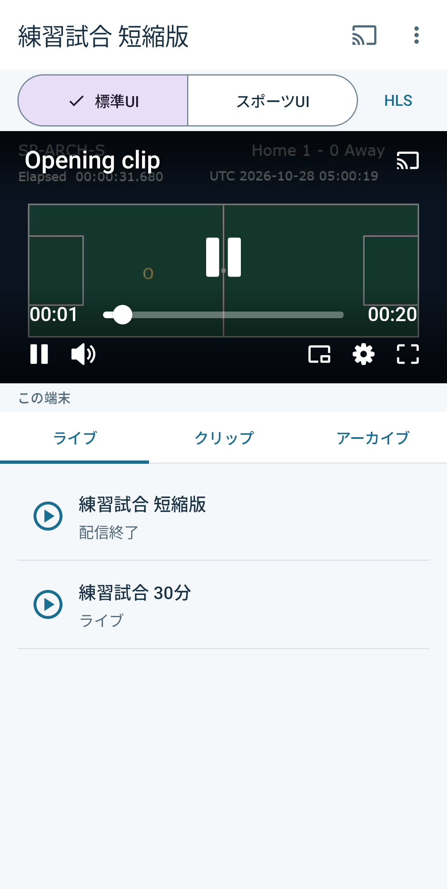
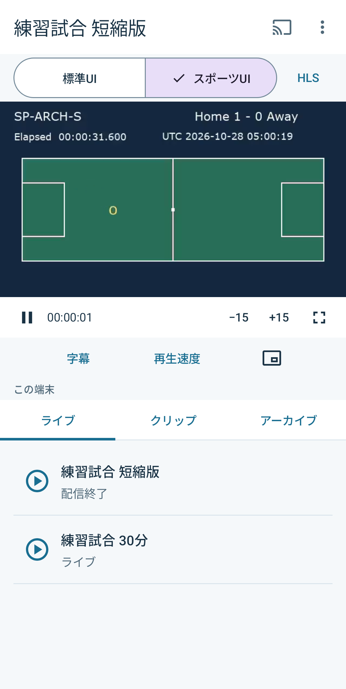
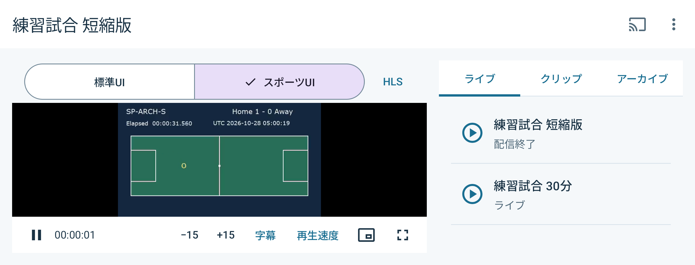

# スポーツ配信用リファレンス

[English](README.md) · [実装ガイド](docs/implementation.md) · [再生品質の分析Web](analytics-web/README.md)

Bitmovin Playerを使ったAndroidのスポーツ配信サンプルです。Live、クリップ、録画アーカイブの再生と切替を試せます。標準Web UIとスポーツ用のネイティブUIを切り替えられ、Google Castにも対応します。

アプリ、設定、Gradle wrapper、素材、分析Webはこのディレクトリ内にあります。このディレクトリをコピーして個別にビルドできます。

## 起動の準備

JDK 21、Android SDK platform 37、build tools 36.0.0を使います。Androidアプリの対象はAndroid 7.0以降です。Player SDKは3.172.0に固定しています。

このディレクトリで設定ファイルを作成してください。

```sh
cp android/.env.example android/.env
```

`android/.env`の`BITMOVIN_PLAYER_LICENSE_KEY`にPlayerキーを設定し、そのライセンスのAndroid許可リストに`com.playerlab.sportsstreaming`を追加してください。再生品質を収集する場合は、Analyticsの`BITMOVIN_ANALYTICS_LICENSE_KEY`も設定します。

親ディレクトリの`.env`は自動では読み込みません。設定を変えたら再ビルドしてください。ライセンスキーはAPKに含まれるため、配布には専用のデモ用ライセンスを使ってください。アカウントの管理APIキーは分析Webのサーバー側にだけ保存します。

`MEDIA_BASE_URL`は素材の配信元です。初期値の`http://10.0.2.2:8622/`はAndroid仮想端末からこのコンピューターへ接続するためのアドレスです。実機とCast受信機では両方から到達できるHTTPSの配信元を指定してください。受信機から端末や仮想端末のlocalhostへは接続できません。

`CATALOG_URL`で、このアプリ専用のカタログを指定できます。省略すると素材配信元の`catalog.json`を取得します。

Analyticsボタンは`ANALYTICS_URL`を開きます。初期値は`http://localhost:9052/`です。[分析Webのサーバー](analytics-web/README.md)を起動し、使う実機または仮想端末へポートを転送してください。

```sh
adb -s DEVICE_SERIAL reverse tcp:9052 tcp:9052
```

ポート転送後はAndroidブラウザーのlocalhostからこのコンピューター上の分析Webへ接続できます。分析Webはlocalhostからの接続だけを受け付けます。使い終わったら`adb -s DEVICE_SERIAL reverse --remove tcp:9052`で転送を解除してください。

## 素材を用意して起動する

ローカル素材の生成にはPython 3.9以降と、`drawtext`フィルターを含むFFmpegが必要です。

```sh
python3 tools/media/media.py generate
python3 tools/media/media.py serve
```

素材サーバーは起動したままにします。macOSのHomebrew版FFmpegで`drawtext`が使えない場合は、`ffmpeg-full`などの対応ビルドを`FFMPEG_BIN`で指定できます。

```sh
FFMPEG_BIN="$(brew --prefix ffmpeg-full)/bin/ffmpeg" python3 tools/media/media.py generate
```

別のターミナルでビルドし、操作する端末を指定してインストールしてください。

```sh
cd android
./gradlew :app:assembleDebug
adb -s DEVICE_SERIAL install -r app/build/outputs/apk/debug/app-debug.apk
adb -s DEVICE_SERIAL shell am start -n com.playerlab.sportsstreaming/.MainActivity
```

短縮イベントはサーバー起動後の実時間で進み、終了後に録画が準備完了になります。通常イベントも実時間で進みます。新しいローカル検証を始める場合はサーバーを再起動してください。シナリオを早送りしても耐久試験を実施したことにはなりません。[素材と配信の説明](docs/fixtures.md)も参照してください。

## 画面と操作

イベント、クリップ、準備が完了した録画を選んで再生します。一覧を見ているだけでは再生しません。HLSとDASHは読み込み前に選択してください。

再生中は標準UIとスポーツUIを切り替えられます。Player、Source、位置、再生・一時停止、速度、字幕、Analyticsのセッションを維持します。

| 標準UI | スポーツUI |
| --- | --- |
|  |  |

巻き戻せる位置は操作時点の視聴可能範囲で決まります。長時間の一時停止後など、古い位置へ戻れない場合は復帰方法を選べます。クリップからLiveへの復帰は初期設定では現在のライブ位置へ戻ります。

横向きでは映像と一覧を左右に配置し、操作ボタンが画面内に収まるようにしています。映像を大きく表示する場合は全画面に切り替えてください。



イベントの終了と録画の準備完了は別の状態です。終了通知だけでは巻き戻し中の視聴を中断しません。録画への切替は初期設定では手動です。時刻の対応が確認できる場合は、自動切替も選べます。対応する位置がない場合に0秒で補うことはありません。一時停止中に切り替えた場合も一時停止を維持します。

ライブが終了しても、再生位置の原点が0になるとは限りません。WebとAndroidでは時刻APIの定義も異なります。[時刻APIの比較](docs/implementation.md#playback-position-and-unix-time)に、Unix時刻と相対時間の扱い、録画へ位置を引き継ぐ際の条件を記載しています。

Castでは使用する受信機を選択します。接続できたことと、受信機で映像が再生されたことは別に確認します。切断時に位置が不明な場合は、端末へ戻る方法を選択できます。

## ビルドとテスト

端末用のテストドライバーにはPython 3.11以降が必要です。`--serial`で指定した端末だけを操作します。仮想端末の起動やADBサーバーの再起動は行いません。

```sh
python3 -B -m unittest discover -s tools/media -p 'test_*.py'
cd android
./gradlew :app:testDebugUnitTest :app:lintDebug :app:assembleDebug :app:assembleDebugAndroidTest
python3.11 tools/check-instrumentation-classes.py
```

素材サーバーを起動した状態で、`android`から実再生のテストを実行します。`DEVICE_SERIAL`と配信元は自分の環境に置き換えてください。

```sh
python3.11 tools/run-device-tests.py \
  --serial DEVICE_SERIAL \
  --media-base-url https://media.example/ \
  --captures --orientation both
```

HLS・DASHで操作を確認し、日英の実画面を撮影します。Castは受信機名を指定する別のテストです。[端末テストの説明](android/README.md#reproducible-device-checks)を参照してください。

全テストではAnalyticsのセッションが維持されることも確認するため、Analyticsキーが必要です。アプリ自体はAnalyticsを無効にしても利用できます。

[検証結果](docs/validation.md)に、ビルド、端末での再生、Cast受信機、実時間の視聴、クラウド素材の条件を記載しています。

再生品質は専用の[分析Web](analytics-web/README.md)から照会できます。引継ぎ操作の端末内記録は標準の再生品質とは別の入力として表示します。送信側の値で受信機の再生品質を補うことはありません。
