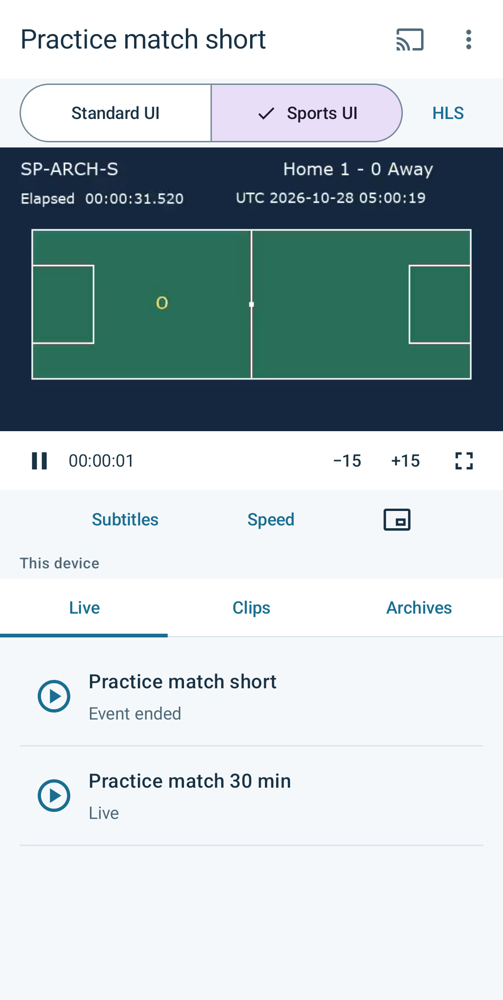
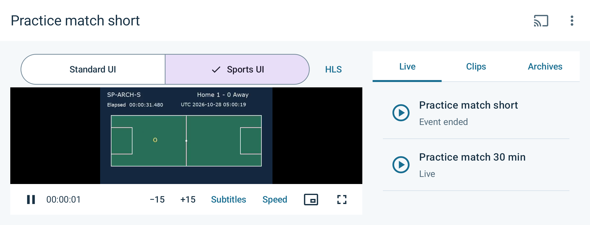

# Sports streaming reference

[日本語](README.ja.md) · [Implementation guide](docs/implementation.md) · [Analytics Web](analytics-web/README.md)

An independent Android example for live events, clips and recorded archives with
Bitmovin Player. Compare the SDK's standard Web UI with native sports controls,
return from a clip to the live stream, and continue into a prepared archive.
A finalized live Source does not necessarily acquire a zero-based clock.
Web and Android also expose different time APIs. See the
[clock comparison](docs/implementation.md#playback-position-and-unix-time)
for Unix time, relative positions and archive handoff conditions.

Google Cast uses the SDK's remote-control integration.

The application, Gradle wrapper, configuration, fixtures, media publisher and
analysis Web application are contained in this directory. Building it does not
require another Player Lab application or shared build output.

## Requirements and configuration

Use JDK 21, Android SDK platform 37 and build tools 36.0.0. The Android
application requires Android 7.0 or later. The Player SDK is pinned to
**3.172.0**, including its integrated Analytics collector.

```sh
cp android/.env.example android/.env
```

Set `BITMOVIN_PLAYER_LICENSE_KEY` to a Player license that allows
`com.playerlab.sportsstreaming`. Optionally set
`BITMOVIN_ANALYTICS_LICENSE_KEY` for playback reporting. This application reads
its own settings; no environment file outside this directory is loaded.

`MEDIA_BASE_URL` points to the media origin. The default,
`http://10.0.2.2:8622/`, reaches the local publisher from the Android emulator.
For a physical phone and Cast receiver, use a reachable HTTPS origin with the
same media paths. The receiver cannot use the phone's or emulator's localhost.
`CATALOG_URL` can point to this application's prepared catalog; when omitted,
the application requests `catalog.json` from its media origin.

The Analytics button opens `ANALYTICS_URL`, which defaults to
`http://localhost:9052/`. Start the [analysis Web server](analytics-web/README.md),
then forward its port to the selected phone or emulator:

```sh
adb -s DEVICE_SERIAL reverse tcp:9052 tcp:9052
```

This connects the Android browser's localhost to the server on this computer.
The server accepts only localhost origins. Remove your forwarding after use
with `adb -s DEVICE_SERIAL reverse --remove tcp:9052`.

Rebuild after changing build settings. Player and collector licenses are
packaged in the APK, so use dedicated demo licenses and an application allowlist.
The account API key belongs only to the analysis server.

## Prepare media and run

The local development publisher uses Python 3.9 or later and FFmpeg with the
`drawtext` filter. Generate this reference's own synthetic sources, then keep
the publisher running:

```sh
python3 tools/media/media.py generate
python3 tools/media/media.py serve
```

If the installed FFmpeg omits `drawtext`, select a compatible executable with
`FFMPEG_BIN`. For example, a macOS Homebrew `ffmpeg-full` installation can be
used with
`FFMPEG_BIN="$(brew --prefix ffmpeg-full)/bin/ffmpeg"` before the generate command.

In another terminal:

```sh
cd android
./gradlew :app:assembleDebug
adb -s DEVICE_SERIAL install -r app/build/outputs/apk/debug/app-debug.apk
adb -s DEVICE_SERIAL shell am start -n com.playerlab.sportsstreaming/.MainActivity
```

The short event runs for three real minutes after the publisher starts. Its
archive becomes ready separately after the event ends. The longer event runs
for thirty real minutes. Restart the publisher to start a new development run;
an accelerated scenario clock is not an endurance test. See
[fixture and delivery notes](docs/fixtures.md).

## Try playback

Browse events, clips and ready archives without starting playback. Select an
asset to load it. Change HLS or DASH before loading a source. Standard and sports
UI modes can be switched during playback while retaining the Player, Source,
position, speed, subtitle selection and Analytics impression.

| Standard UI | Sports UI |
| --- | --- |
|  |  |

Sports controls include play/pause, short seeks, subtitle and speed selection,
and return to the live edge. A live seek is checked against the current seekable
window when the operation is dispatched. A saved clip-return position is only
offered while it remains seekable.

Landscape places playback beside the asset list and keeps the controls in view.
Use fullscreen for a larger video area.



Event-ended and archive-ready are separate states. An end notification leaves
current playback running. Continuing into an archive is an explicit choice by
default; automatic continuation requires a verified time mapping. A missing or
expired mapping must not be replaced with zero seconds. Paused playback remains
paused when a valid handoff completes.

For Cast, select the intended receiver and confirm the actual remote asset,
position and state. A connected receiver application alone does not prove
successful playback. When a remote position is unknown, choose how to return
to the phone rather than inventing a resume position.

## Check and inspect

The device-test driver requires Python 3.11 or later. It selects only the device
specified by `--serial`; it does not start an emulator or restart an ADB server.

```sh
python3 -B -m unittest discover -s tools/media -p 'test_*.py'
cd android
./gradlew :app:testDebugUnitTest :app:lintDebug :app:assembleDebug :app:assembleDebugAndroidTest
python3.11 tools/check-instrumentation-classes.py
```

For actual HLS and DASH playback checks, keep the media publisher running and
run this command from `android` with licensed, reachable media:

```sh
python3.11 tools/run-device-tests.py \
  --serial DEVICE_SERIAL \
  --media-base-url https://media.example/ \
  --captures --orientation both
```

Replace the example origin with your own delivery origin. The driver records
executed counts and APK hashes. Cast is a separate opt-in check with an exact
receiver name; see the [device-test instructions](android/README.md#reproducible-device-checks).
The complete device suite requires an Analytics license for actual impression
continuity checks; the application can otherwise run with Analytics disabled.
The
[validation record](docs/validation.md) separates builds, device playback,
real-time runs, Cast receiver playback and cloud preparation.

The [analysis Web application](analytics-web/README.md) reads standard playback
quality metrics through a dedicated localhost server. Local handoff records
remain a separate input. They do not measure receiver playback quality.
