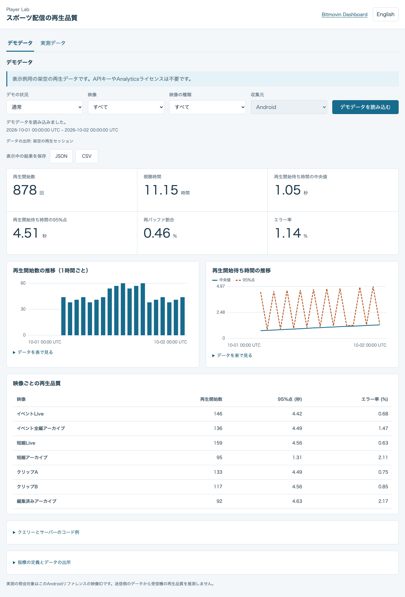
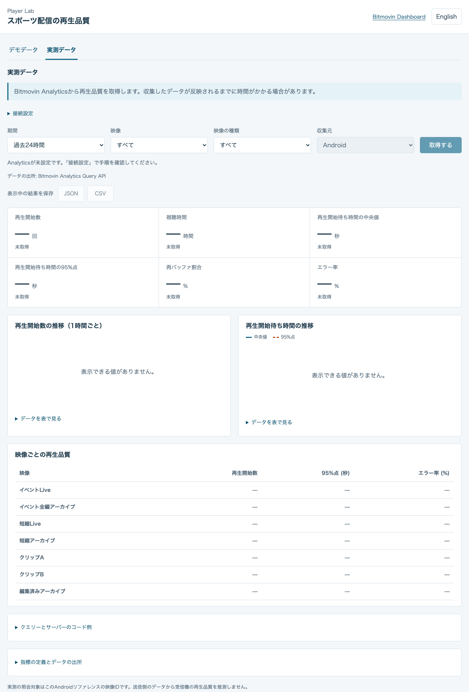

<a id="sports-playback-quality-dashboard"></a>
# スポーツ配信の再生品質ダッシュボード

[English](README.md) · [日本語](README.ja.md)

デモデータで再生品質の指標を確認し、Bitmovin Analyticsから実測データを取得できます。画面は日本語と英語に対応し、Androidアプリをビルドせずに単独で起動できます。

Androidでの再生から収集結果を確認するまでの流れは、[再生からAnalyticsでの確認まで](../docs/analytics.ja.md)を参照してください。

<a id="run-locally"></a>
<a id="setup"></a>
## ローカルで起動する

Node.js 24系の24.13以降を使ってください。

```sh
cd analytics-web
npm ci
npm start
```

`http://127.0.0.1:9052`を開きます。初期画面の「デモデータ」はAPIキーやAnalyticsライセンスなしで利用できます。任意の設定項目`PORT`の既定値は`9052`です。

<a id="demo-data"></a>
## デモデータ

カード、時間別グラフ、映像ごとの比較には、固定したサンプル日の架空の再生セッションを使います。画面にはデモであることと、サンプルの対象期間を表示します。「通常」「開始待ちが長い」「再バッファが多い」を切り替えて比較できます。映像と種類を変更すると、選択条件に合わせてローカルの値を計算します。「デモデータを読み込む」もBitmovinへ接続せずに再表示します。実際の再生セッションやアカウントの計測データは作成しません。



<a id="measured-data"></a>
## 実測データ

このディレクトリにサーバー用の`.env`を作成します。

```sh
cp .env.example .env
```

`BITMOVIN_API_KEY`にはAnalyticsの読み取りクエリーを実行できるアカウントAPIキーを、`BITMOVIN_ANALYTICS_LICENSE_KEY`にはこのアプリのAnalyticsライセンスを設定します。PlayerライセンスキーはアカウントAPIキーではありません。読み込むのはこのディレクトリの`.env`だけで、親ディレクトリやAndroidの設定は使いません。`.env`は公開しないでください。キーはサーバーだけで保持し、ブラウザーへ返しません。

設定を変更したらサーバーを再起動してください。

```sh
npm start
```

`http://127.0.0.1:9052/#measured`を開き、期間、映像、種類を選んで「取得する」を押します。画面を開いたり、条件を変更したりするだけではAnalyticsへ問い合わせません。取得操作のたびに新たなAPIクエリーを実行します。同じ条件の要求が重なった場合は、処理中の問い合わせを共有します。未設定、データなし、有効な0の値、一部の結果だけ取得できた状態、失敗を区別します。クエリーが失敗したときに、デモ値を実測値として表示することはありません。



このダッシュボードは既存の計測結果を読み取るもので、データ収集を開始するものではありません。収集したイベントが集計結果に反映されるまでに時間がかかる場合があります。取得時刻はサーバーがAPIの応答を受け取った時刻であり、最新の元サンプルが記録された時刻ではありません。

<a id="playback-quality"></a>
## 再生品質

実測のクエリーはプラットフォームをAndroidに固定し、`config.mjs`に記載した`sports:SP-*`の映像IDだけを対象にします。種類のフィルターもこれらの既知のIDを選択します。custom dataの項目は使いません。送信側の計測値だけでは受信機の再生品質を判断できません。

| 指標 | クエリー | 表示 |
| --- | --- | --- |
| 再生開始数 | `VIDEO_STARTUPTIME > 0`を条件に`IMPRESSION_ID`を数える | 回数 |
| 視聴時間 | `PLAYED > 0`を条件に`PLAYED`を合計 | ミリ秒を3,600,000で割る |
| 再生開始待ち時間の中央値 | 正の`VIDEO_STARTUPTIME`の中央値 | ミリ秒を1,000で割る |
| 再生開始待ち時間の95%点 | 正の`VIDEO_STARTUPTIME`の95パーセンタイル | ミリ秒を1,000で割る |
| 再バッファ割合 | `REBUFFER_PERCENTAGE`の平均 | APIの標準の割合の尺度 |
| エラー率 | `ERROR_PERCENTAGE`の平均 | APIの標準の割合の尺度 |

実測のクエリーでは任意のコンテキスト列を明示的に無効にし、指標の結果形式だけを読み取ります。カードは期間全体を照会し、時間別グラフと映像ごとの比較はそれぞれ別に照会します。時間別のパーセンタイルを平均して期間全体の値にしたり、欠けた時間帯を0で補ったり、欠損区間を線でつないだりはしません。グラフにはデータの表も付けています。デモ値は架空のセッションから別に計算し、期間全体のパーセンタイルも個々のセッションから求めます。

Bitmovin Dashboardと比較するときは、期間と映像IDを揃えてください。指標の照会は[公式の照会例](https://developer.bitmovin.com/playback/docs/how-to-recreate-dashboard-queries-via-the-api-1)と[Percentile APIリファレンス](https://developer.bitmovin.com/playback/reference/postanalyticsqueriespercentile)に従っています。

<a id="queries-and-export"></a>
## クエリー例と結果の保存

画面の「クエリーとサーバーのコード例」では、指標ごとの定義と単位、表示条件に合ったJSONとNode.jsコードを確認してコピーできます。サーバーの実際の照会と共通の関数から例を生成します。例を開いたりコピーしたりするだけではAPIへ接続しません。

「表示中の結果を保存」ではJSONとCSVをダウンロードできます。デモと実測、元の期間と条件、取得時刻、単位、欠損、一部の取得失敗、前回結果の区別を保持します。[結果の保存と分析](docs/analysis.ja.md)に、各項目の意味と公開デモを使ったLLM分析の例を記載しています。

<a id="server-limits-and-checks"></a>
## サーバーの制限と確認方法

サーバーは`127.0.0.1`だけで待ち受け、HostとOriginを検証します。配信するのは固定した静的ファイル、`GET /api/config`、`GET /api/qoe`だけです。クライアントから上流URL、ライセンス、アカウントキー、集計軸、プラットフォームを指定することはできません。認証のないローカル開発用サーバーのため、外部へ公開しないでください。

実測の照会期間は最大7日間で、時間別グラフは1時間単位です。上流への同時リクエストは最大3件、照会バッチ全体の制限時間は10秒です。同時に保持する異なるバッチは最大2つで、完了済みの結果を次の取得操作に再利用しません。ページごとに200行と`offset`を使い、ページ取得回数と応答サイズにも上限を設けています。レート制限時は`Retry-After`に従い、制限時間内で短い再試行を最大1回行います。失敗した値や欠けた値は未取得のままにします。取得に失敗した後も以前の成功結果を残す場合は、前回の値であることを画面に表示します。

```sh
npm test
npm run build
npx playwright install chromium
npm run test:browser
```

テスト対象はデモの状況とフィルター、クエリー例と実際の照会の一致、JSON・CSVの保存、秘密項目の除外、繰り返しの取得で新たに行う照会、クエリーの形式、プラットフォーム・映像のフィルター、ページ分割、並列処理、レート制限、制限時間、応答サイズ、Origin検証、秘密情報を含まないエラー、古い応答の破棄、グラフの欠損区間です。`build`はモジュールと静的ファイルを確認します。生成済みのバンドルや実行時依存パッケージは不要です。
