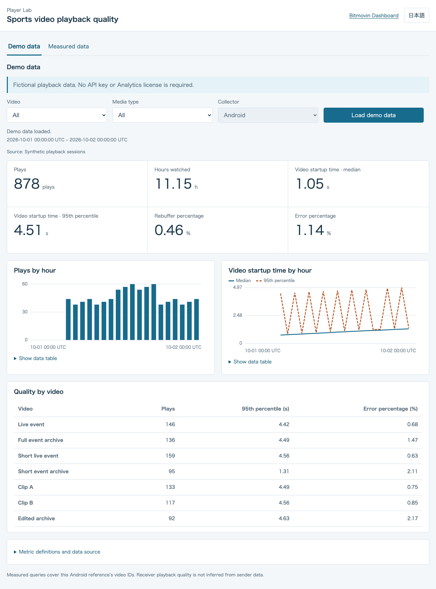
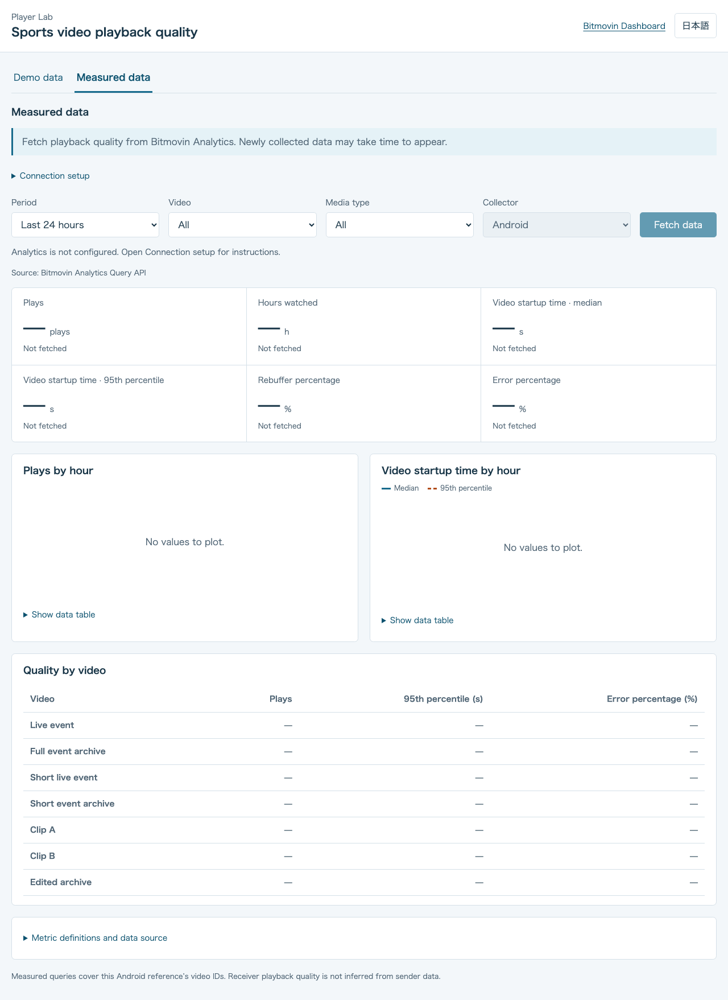

# Sports playback quality dashboard

[English](README.md) · [日本語](README.ja.md)

Explore playback-quality metrics with demo data, then fetch measurements from Bitmovin Analytics. The dashboard supports English and Japanese and runs independently of the Android build.

<a id="setup"></a>
## Run locally

Use Node.js 24.13 or later within the Node.js 24 release line.

```sh
cd analytics-web
npm ci
npm start
```

Open `http://127.0.0.1:9052`. The initial **Demo data** screen works without an API key or Analytics license. The optional `PORT` setting defaults to `9052`.

## Demo data

The cards, hourly charts and video comparison use fictional playback sessions from a fixed sample day. The page identifies the data as a demo and shows its actual sample period. Video and media-type filters recalculate the local example; **Load demo data** reloads it without contacting Bitmovin. No playback sessions or account measurements are created.



## Measured data

Create the server's private settings file in this directory:

```sh
cp .env.example .env
```

Set `BITMOVIN_API_KEY` to a Bitmovin account API key with Analytics read-query permissions and `BITMOVIN_ANALYTICS_LICENSE_KEY` to this app's Analytics license. A Player license key is not an account API key. Only this directory's `.env` is loaded; parent directories and Android configuration are not used. Keep `.env` private. Keys remain on the server and are never returned to the browser.

Restart the server after changing the settings:

```sh
npm start
```

Open `http://127.0.0.1:9052/#measured`, choose the period, video and media type, then select **Fetch data**. Entering this screen or changing a filter does not query Analytics. Each fetch makes new API queries; overlapping identical requests share work already in progress. Missing configuration, no data, valid zero values, partial results and failures are separate states. A failed query never displays demo values as measurements.



The dashboard reads existing measurements. It does not start collection. Newly collected events may take time to appear in the aggregated results. The fetch time is when the server received an API response; it is not the latest underlying sample timestamp.

## Playback quality

The server fixes the platform to Android and limits measured queries to the `sports:SP-*` video IDs declared in `config.mjs`. Media-type filters select those known IDs. No custom data fields are used. Sender measurements do not establish receiver playback quality.

| Metric | Query | Display |
| --- | --- | --- |
| Plays | Count `IMPRESSION_ID` with `VIDEO_STARTUPTIME > 0` | Count |
| Hours watched | Sum `PLAYED` with `PLAYED > 0` | Milliseconds divided by 3,600,000 |
| Video startup time, median | Median positive `VIDEO_STARTUPTIME` | Milliseconds divided by 1,000 |
| Video startup time, 95th percentile | Percentile 95 of positive `VIDEO_STARTUPTIME` | Milliseconds divided by 1,000 |
| Rebuffer percentage | Average `REBUFFER_PERCENTAGE` | Standard API percentage scale |
| Error percentage | Average `ERROR_PERCENTAGE` | Standard API percentage scale |

Measured queries explicitly disable optional context columns and consume only the metric result shape. Cards use whole-period queries; hourly plots and video comparisons use separate queries. Hourly percentiles are not averaged into a period value. Missing hours are not filled with zero or connected by a line. Data tables accompany the charts. Demo values are calculated separately from synthetic sessions, including whole-period percentiles from individual sessions.

Compare the same period and video IDs in Bitmovin Dashboard. Metric requests follow the [official query recipes](https://developer.bitmovin.com/playback/docs/how-to-recreate-dashboard-queries-via-the-api-1) and [Percentile API reference](https://developer.bitmovin.com/playback/reference/postanalyticsqueriespercentile).

## Server limits and checks

The server binds to `127.0.0.1` and validates host/origin. Only fixed static files, `GET /api/config`, and `GET /api/qoe` are served. Clients cannot choose an upstream URL, license, account key, query dimension or platform. This unauthenticated local development server must not be exposed publicly.

Measured queries cover at most seven days with hourly plots, at most three concurrent upstream requests and a ten-second whole-batch deadline. At most two distinct batches run at a time. Completed results are not reused for a later fetch. Pages use 200 rows and `offset`, with bounded pagination and response sizes. Rate limits respect `Retry-After`, with at most one short retry within the deadline. Failed or missing values stay unavailable. Earlier successful values retained after a failed fetch are labeled as earlier results.

```sh
npm test
npm run build
```

Tests cover synthetic-data filtering, new queries on repeated fetches, query contracts, platform/video filters, pagination, concurrency, rate limits, deadlines, response limits, origin checks, secret-free errors, stale response rejection and chart gaps. `build` checks modules and static assets. No generated bundle or runtime dependency is required.
