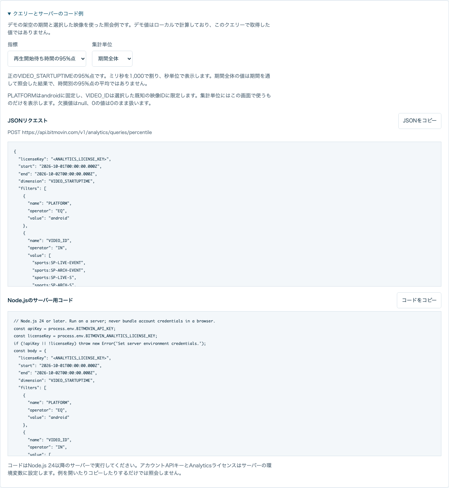

<a id="export-results-and-analyze-them"></a>
# 結果の保存と分析

[English](analysis.md) · [日本語](analysis.ja.md) · [ダッシュボードの設定](../README.ja.md)

デモの状況を切り替えると、Analyticsを組み込む前に再生品質の違いを確認できます。デモは認証情報なしでローカルで動作します。実測データはサーバーから照会し、デモとは分けて表示します。

<a id="compare-fictional-scenarios"></a>
## デモの状況を比較する

「デモデータ」で「通常」「開始待ちが長い」「再バッファが多い」を選択します。選択中の映像と種類は維持されます。どの状況でも同じ架空の再生セッションを使います。「開始待ちが長い」は各セッションの開始待ち時間を4倍にし、「再バッファが多い」は各セッションの再バッファ割合を一定の計算方法で増やします。再生開始数、視聴時間、エラーの値は変えないため、対象の指標を比較できます。

カード、時間別グラフ、映像ごとの比較は、そのセッションから計算し直します。期間全体の中央値と95%点は個々の開始待ち時間から求め、時間別の95%点を平均しません。表示する日付は固定した架空の期間で、最近のアカウントの実測値ではありません。状況を切り替えてもAPIへ接続せず、再生イベントも作成しません。

<a id="read-and-copy-a-query"></a>
## クエリーを確認してコピーする

「クエリーとサーバーのコード例」を開き、指標と集計単位を選択します。指標の定義、単位、JSONリクエスト、送信先、Node.jsのコードを確認できます。選択できるのは、この画面で使う期間全体のカード、対応する時間別グラフと映像ごとの比較です。

結果を表示している場合は、その結果の元の期間と絞り込み条件を例に使います。再取得に失敗して前回の値を残している場合も同様です。実測の初回取得前は現在の有効な選択条件を使います。デモでは架空の期間を使い、照会例であることを明記します。例を開く、選択する、コピーする操作ではリクエストを送信しません。

JSONには`<ANALYTICS_LICENSE_KEY>`を表示します。Node.jsのコードはサーバーの環境変数`BITMOVIN_API_KEY`と`BITMOVIN_ANALYTICS_LICENSE_KEY`を読み取ります。コピーしたコードをダッシュボードのディレクトリに`query-example.mjs`として保存し、Node.js 24で実行してください。

```sh
node --env-file=.env query-example.mjs
```

`.env`には非公開の[サーバー設定](../README.ja.md#measured-data)を使ってください。アカウントAPIキーをブラウザーのコードへ追加しないでください。保存したコードを実行すると、表示したクエリーをBitmovin Analyticsへ送信します。デモ値をローカルで計算する操作ではありません。コードは集計値を画面と同じ単位で出力し、`null`を維持します。ページ取得回数、応答サイズ、実行時間にも上限があります。ダッシュボードのサーバーはさらに同時照会とレート制限時の再試行を調整します。定義は[公式の指標照会例](https://developer.bitmovin.com/playback/docs/how-to-recreate-dashboard-queries-via-the-api-1)でも確認できます。



<a id="export-what-is-displayed"></a>
## 表示中の結果を保存する

「表示中の結果を保存」の横にある「JSON」または「CSV」を押します。ファイルはローカルで作成し、外部へアップロードしません。結果がないときと取得中は保存できません。実測の絞り込み条件を変えると結果を消し、次の取得が終わるまで保存を無効にします。

| 項目 | 意味 |
| --- | --- |
| `schemaVersion` | 出力形式のバージョン。現在は`1` |
| `dataSource`、`scenario` | `demo`または`measured`。デモの状況、実測では`null` |
| `period`、`filters` | 表示中の結果が対象としたUTCの期間、映像、種類、Androidの条件 |
| `requestedAt`、`fetchedAt`、`exportedAt` | 照会開始、成功したAPI応答のうち最後に受け取った時刻、ローカルでのファイル作成時刻 |
| `latestSampleAt` | `null`。この集計では最新の元イベントの時刻はわからない |
| `dataStatus`、`viewStatus`、`isEarlier` | 保存するデータの状態、現在の画面の状態、前回結果を表示しているか |
| `metrics`、`series`、`comparison` | 既知の集計値、単位、照会ごとの状態と定義済みのエラーコード |

デモの照会時刻と取得時刻は`null`です。再取得に失敗した場合、前回成功した結果や部分的な結果を残すことがあります。その場合は`isEarlier`が`true`になり、`viewStatus`に再取得の失敗を記録します。元の期間、条件、値、取得時刻は維持します。未取得の指標は`null`、有効な0の値は`0`のままです。照会の失敗を0とみなしたり、一部しか取得できていない結果を完全な結果として扱ったりしないでください。

JSONは配列と値の型を維持します。CSVは各指標の行に同じ出所と条件を記し、集計の種類と単位も示します。`null`のセルは空欄です。失敗した系列や空の系列も、状態を示す行として出力します。CSVはセルを引用符で囲み、数式として解釈される可能性のある文字列を処理します。`null`の型を正確に扱う場合や、表計算ソフトで保存し直して再び開く場合はJSONを使ってください。未知の応答項目、アカウントの認証情報、視聴者の識別子、未加工のセッションは出力しません。

<a id="try-an-llm-with-public-demo-data"></a>
## 公開デモでLLMによる分析を試す

[再バッファが多い状況の架空の出力例](../examples/demo-rebuffering.json)は、このダッシュボードのデモセッションから生成したJSONです。アカウントの実測値や認証情報を含まず、Analyticsの設定なしで確認できます。LLM（大規模言語モデル）で試す場合は、例えば次のように依頼できます。

> 添付した架空の再生品質JSONをデモとして分析してください。
> 最初にdataSource、scenario、period、filters、dataStatus、isEarlierを示してください。
> 出力済みの値と単位だけを使い、nullと0を区別してください。
> 開始待ち時間の中央値、95%点、再バッファ割合を比較し、
> 調査すべき映像や時間帯を挙げてください。時間別の95%点を平均して
> 期間全体の95%点を作らないでください。値から読める傾向と仮説を分け、
> この集計だけでネットワーク、端末、コンテンツの原因を断定しないでください。
> 各仮説を確かめるために必要な追加の測定を挙げてください。

この公開例から読み取れるのは、架空の状況で再バッファ割合が増えていることです。実際の障害を示すものではありません。出力にはネットワークの記録、端末別の内訳、各割合の元になるサンプル数がないため、LLMが提案した仮説は追加の測定とBitmovin Dashboardで確認してください。実測の出力を外部サービスへ渡す場合は、データの取り扱い規程で許可されているか確認してください。アプリから外部のLLMを呼び出したり、保存した結果を自動送信したりすることはありません。
