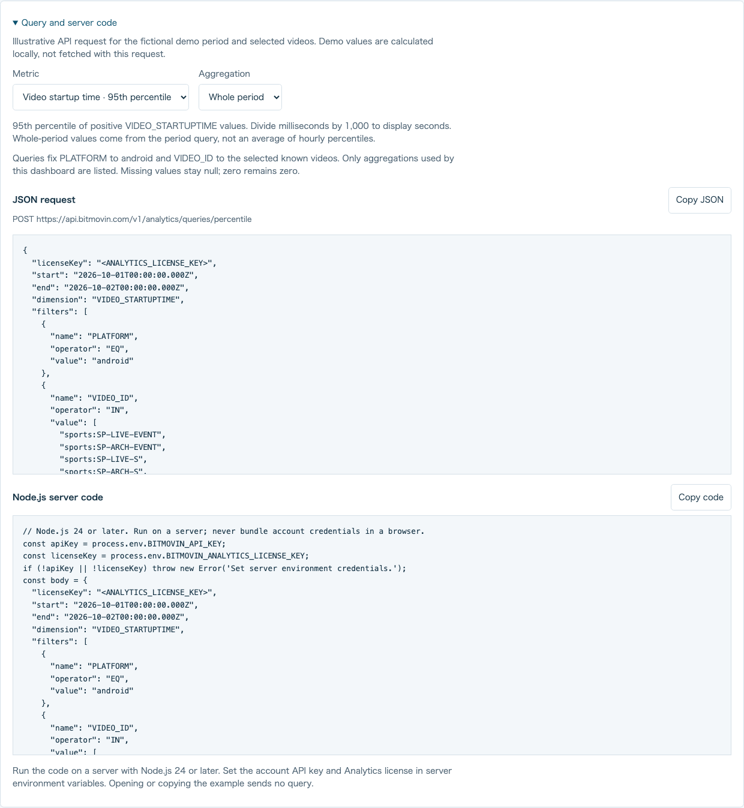

# Export results and analyze them

[English](analysis.md) · [日本語](analysis.ja.md) · [Dashboard setup](../README.md)

Use the dashboard to compare playback behavior before adding an Analytics integration. Demo scenarios work locally without credentials. Measured results require a server-side query and remain separate from the demo.

## Compare fictional scenarios

On **Demo data**, choose **Normal**, **Slow start**, or **High rebuffering**. Video and media-type filters remain selected. The same fictional playback sessions are used for each scenario. Slow start multiplies each session's startup time by four; High rebuffering adds a deterministic increase to each session's rebuffer percentage. Playback counts, watch time and errors stay unchanged, so the affected metric is easier to compare.

Cards, hourly trends and video comparisons are recalculated from those sessions. Whole-period medians and 95th percentiles use individual startup times; hourly percentile values are not averaged. The displayed day is a fixed fictional period, not a recent account measurement. Changing the scenario does not call an API or create a playback event.

## Read and copy a query

Open **Query and server code**, then select a metric and aggregation. The panel shows the metric definition, units, JSON request, endpoint and Node.js code. Only query combinations used by this dashboard are available: whole-period cards, the supported hourly trends and the supported video comparisons.

If results are displayed, the example uses their original period and filters, including when an earlier successful result remains after a failed refresh. Before a measured fetch, it uses the current valid selection. In demo mode, the example uses the fictional demo period and explicitly identifies it as an illustration. Opening, selecting or copying a query does not send a request.

The JSON contains `<ANALYTICS_LICENSE_KEY>`. The Node.js code reads `BITMOVIN_API_KEY` and `BITMOVIN_ANALYTICS_LICENSE_KEY` from server environment variables. Save the copied code as `query-example.mjs` in the dashboard directory and run it with Node.js 24:

```sh
node --env-file=.env query-example.mjs
```

Use the private [server settings](../README.md#measured-data) for that file. Never add an account API key to browser code. Running the saved code sends the shown query to Bitmovin Analytics; it is not a local demo calculation. It prints aggregate values in the displayed units, retains `null`, and bounds pagination, response size and execution time. The dashboard server additionally coordinates concurrent queries and rate-limit retries. Compare definitions with the [official metric recipes](https://developer.bitmovin.com/playback/docs/how-to-recreate-dashboard-queries-via-the-api-1).



## Export what is displayed

Select **JSON** or **CSV** beside **Export displayed results**. A file is created locally; it is not uploaded. Export is unavailable before results exist and while a fetch is running. Changing a measured filter clears the displayed results and disables export until another fetch completes.

| Field | Meaning |
| --- | --- |
| `schemaVersion` | Export format version, currently `1` |
| `dataSource`, `scenario` | `demo` or `measured`; a demo scenario or `null` for measured data |
| `period`, `filters` | The original displayed result's UTC period, video, media type and Android scope |
| `requestedAt`, `fetchedAt`, `exportedAt` | Query start, latest successful API response receipt, and local file creation time |
| `latestSampleAt` | `null`; these aggregate queries do not establish the newest underlying event time |
| `dataStatus`, `viewStatus`, `isEarlier` | Status of the exported data, current screen status, and whether an earlier result is still displayed |
| `metrics`, `series`, `comparison` | Known aggregate values, units, per-query statuses and normalized error codes |

Demo query timestamps are `null`. A failed refresh can leave earlier successful or partial results on screen: `isEarlier` is `true`, `viewStatus` records the failed refresh, and the original period, filters, values and receipt time remain unchanged. An unavailable metric stays `null`, whereas a valid zero remains `0`. Do not treat a failed query as zero or combine partial results as if all queries succeeded.

JSON retains structured arrays and typed values. CSV repeats the same provenance on every metric row, identifies the section and unit, and leaves null values blank. An error or empty series still gets a status row. CSV quotes cells and escapes formula-like text; use JSON if exact null types matter or if you plan to save and reopen files in spreadsheet software. Unknown response fields, account credentials, viewer identifiers and raw session records are not included.

## Try an LLM with public demo data

The [fictional rebuffering example](../examples/demo-rebuffering.json) is a JSON export generated from this dashboard's demo sessions. It contains no account measurements or credentials. It is safe to inspect without configuring Analytics. The following prompt can be used with a language model of your choice:

> Analyze the attached fictional playback-quality JSON as a demonstration.
> First report dataSource, scenario, period, filters, dataStatus and isEarlier.
> Use only the exported values and units; distinguish null from zero.
> Compare startup median, startup p95 and rebuffer percentage, then identify
> which videos or hours warrant investigation. Do not average hourly p95
> values to invent a whole-period p95. Separate observed patterns from
> hypotheses. Do not assert a network, device or content cause from these
> aggregates. List the additional measurements needed to test each hypothesis.

For the public example, the expected observation is increased rebuffering in a fictional scenario; it is not evidence of a live incident. A language model may suggest investigations, but the export has no network traces, device breakdown or sample counts for each percentage. Confirm any hypothesis with appropriate measurements and Bitmovin Dashboard. Do not upload measured exports to an external service unless your data-handling policy permits it. This application never calls an external language model or sends an export automatically.
