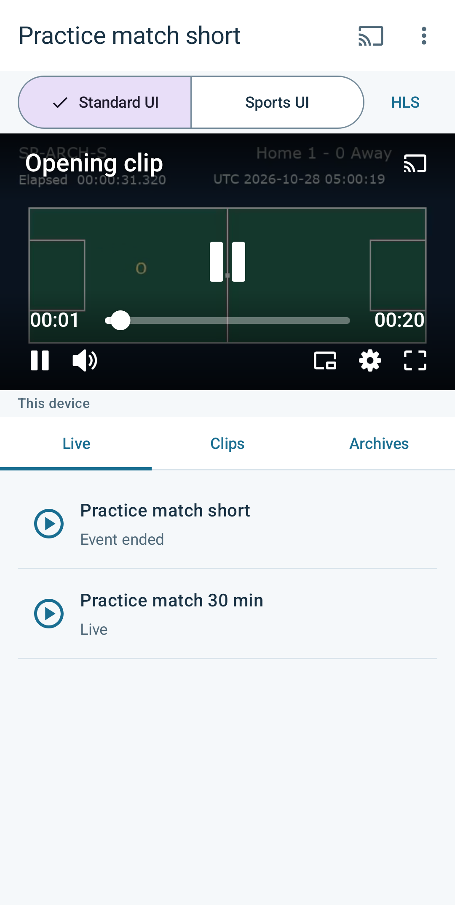

# From sports playback to Analytics

[English](analytics.md) · [日本語](analytics.ja.md)

Use this sequence to find this Android app's playback data in Bitmovin Dashboard
and in the local quality dashboard. The Android collector sends playback events;
the local server queries data already collected. The [key-free demo](../analytics-web/README.md#demo-data)
can be tried without building Android or configuring an account.

## Configure Android

Follow [Requirements and configuration](../README.md#requirements-and-configuration)
and [Prepare media and run](../README.md#prepare-media-and-run) to create
`android/.env`, prepare reachable media, build and install the application.

| Setting | Where it is used | Purpose |
| --- | --- | --- |
| `BITMOVIN_PLAYER_LICENSE_KEY` | `android/.env` | Authorizes Player playback for `com.playerlab.sportsstreaming`. |
| `BITMOVIN_ANALYTICS_LICENSE_KEY` | `android/.env` and `analytics-web/.env` | Enables Android data collection and selects the same license's data for local queries. |
| `BITMOVIN_API_KEY` | `analytics-web/.env` only | Authorizes server-side Analytics queries in the account that owns that Analytics license. |

Allow `com.playerlab.sportsstreaming` on the Player license and the Analytics
license. Analytics licenses are under **Observability → Licenses** in Bitmovin
Dashboard; see the [official license setup](https://developer.bitmovin.com/playback/docs/setup-analytics).
Use sample licenses: Android packages its Player and Analytics licenses in the
application. Keep the account API key only on the local server.

The Android build and analytics server load their own `.env` files; neither
loads the other's settings. Rebuild and reinstall Android after changing its
keys, and restart the local server after changing its settings. Playback works
with collection disabled, so successful video playback does not prove that
Analytics is configured.

Android uses the process environment before `android/.env`, then falls back to
the default. The Node server likewise gives inherited `BITMOVIN_API_KEY` and
`BITMOVIN_ANALYTICS_LICENSE_KEY` precedence over `analytics-web/.env`. If an
edited file has no effect, remove or align the higher-priority environment
setting before rebuilding or restarting. Restarting the server alone does not
clear an exported value. Check where overrides are set without printing their
values.

## Play a known clip

Open **Clips**, select **Opening clip**, and confirm that video frames and the playback
position advance before pausing. Note when you played it. This clip is available
without waiting for a live event to finish. Browsing an asset list alone does
not start a playback session.

The app and local dashboard use different display names for the same Video IDs:

| Android selection | Local dashboard video | Analytics `VIDEO_ID` |
| --- | --- | --- |
| Opening clip | Clip A | `sports:SP-CLIP-A` |
| Short practice match | Short live event | `sports:SP-LIVE-S` |
| Practice replay | Short event archive | `sports:SP-ARCH-S` |

The `sports:` prefix is part of the Video ID. HLS and DASH share that ID. The
complete list is in the [catalog](../fixtures/catalog.json) and
[dashboard configuration](../analytics-web/config.mjs). The local **Media type**
filter selects known IDs for live, clip or archive content; it is not a separate
Analytics custom-data field.

## Find the playback in Bitmovin Dashboard

1. Open [Bitmovin Dashboard](https://dashboard.bitmovin.com/analytics) with access
   to the account that owns your Analytics license.
2. Select the same Analytics license configured in Android and a period that
   includes the playback you noted.
3. Filter to Android and Video ID `sports:SP-CLIP-A`. Inspect plays, startup time
   and rebuffering for that selection.

The local dashboard uses coordinated universal time (UTC) for displayed and
custom-entered periods. For example, 12:00 in Japan is 03:00 UTC. Match the time
zones when comparing screens. **Last 24 hours** ends at the start of the current
minute. Recently collected events may take time to appear. The fetch time is when the
server received the API response, not the latest playback event's time.

The [official metric definitions](https://developer.bitmovin.com/playback/docs/analytics-dashboard-metrics-reference)
and the local [query definitions](../analytics-web/README.md#playback-quality)
explain the aggregates. Match the metric, license, period and filters before
comparing values.

## Fetch the same data locally

Follow [Measured data](../analytics-web/README.md#measured-data) to create
`analytics-web/.env`, set the account API key and the same Analytics license, and
start the server. Its setup and startup commands are listed there. The account
API key needs permission to query Analytics.

On the development computer, open `http://127.0.0.1:9052/#measured`. Select
**Last 24 hours**, **Clip A** and **All** media types, then select **Fetch data**.
A page load or filter change does not query Analytics; each fetch requests new
results. To open this server from Android's **Analytics** menu instead, use the
[ADB port-forwarding setup](../README.md#requirements-and-configuration).

The server restricts queries to Android and the configured `sports:SP-*` Video
IDs. Fetching does not collect events or create playback sessions. **Demo data**
uses fictional sessions and never adds measurements to your account.

This first check uses local Android playback. Cast receiver quality requires a
collector on the receiver and verified receiver metadata. Android sender data
does not establish the receiver's startup time, buffering or errors.

## When results are missing

| What you see | What to check |
| --- | --- |
| Android cannot play | Confirm the Player key, package allowlist and media reachability using the [Android setup](../README.md#requirements-and-configuration). Rebuild and reinstall after configuration changes. |
| Playback works, but Dashboard has no data | Check Android's Analytics key and its package allowlist. Confirm that the device can reach collection, then open **Diagnostics** from the playback options to inspect the collector configuration. |
| Dashboard has data, but local fetch is unavailable | Check `analytics-web/.env`, its account API key and Analytics key, then restart that server. Android's `.env` does not configure it. |
| Local fetch succeeds but shows no data | Match the Analytics license, period and complete Video ID, including `sports:`. Start with **All** media types. Only IDs in the dashboard configuration are queried. |
| Only recent playback is missing | Wait for ingestion and for the selected period to include that playback, then fetch again. Missing data is not replaced with zero. |
| Fetch fails or only some results arrive | Read the query status. Check API access and connectivity. For partial results or a timeout, try a shorter period and fetch again; if rate limited, wait until the displayed retry time. Earlier successful values, when retained, are identified as such. |

A valid zero, no data and a query failure are different states. See the
[dashboard guide](../analytics-web/README.md) for their display and the server's
query limits.
